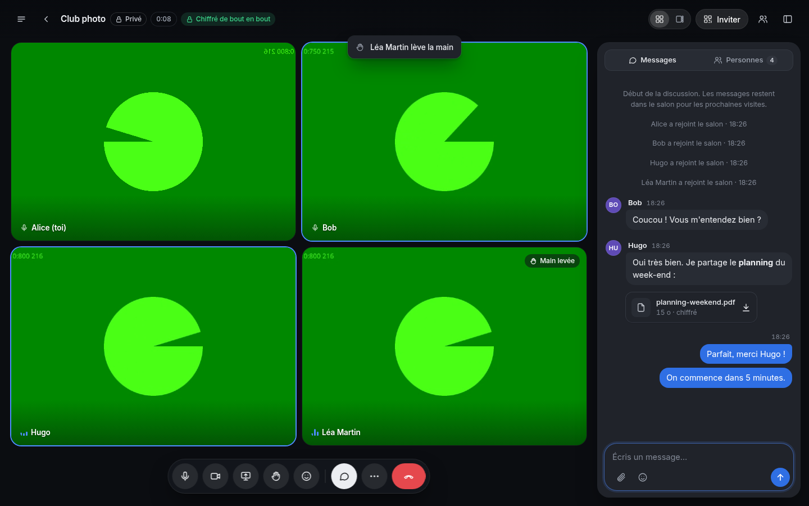

# ChatSysVisio

*[English](README.md) · Français*



Visio et messagerie auto-hébergées, en français, pour 25 personnes par salon — **uniquement via HTTPS 443**.
Dérivé de [Camus](https://github.com/camuschat/camus) (AGPL-3.0, voir `NOTICE.md`).

- Salons publics ou privés, mot de passe, limite de participants, page des salons publics.
- **Chiffrement de bout en bout** (1.3) des salons privés et à mot de passe : vidéo, son, écran, chat, réactions,
  fichiers et historique illisibles pour le serveur ; clé dans le lien (`#k=…`), code de sécurité à comparer.
  Les salons publics ne sont **pas** chiffrés de bout en bout (TLS jusqu'au serveur) et l'affichent.
- Vidéo jusqu'en **1080p** (réglage Auto / 360p / 720p / 1080p / Éco, HD envoyée seulement à qui l'affiche en grand,
  adaptation automatique), mosaïque paginée, orateur mis en avant, son, partage d'écran 1080p, plein écran, image dans l'image.
- Chat : réponses, Markdown, réactions, fichiers et images, « … écrit », présence.
- Salle d'attente : aperçu caméra, niveau du micro, choix des périphériques, flou / arrière-plans.
- Main levée, réactions, invitation par lien ou QR code local, appli installable (PWA), thème sombre / clair.
- **Administration** (1.2, réseau local seulement, mot de passe + TOTP) : statistiques, salons et participants
  (exclure, bannir, fermer), réglages à chaud, comptes et invitations, journal, sauvegardes et mises à jour système.
- **Interface 1.4** (bleu calme depuis 1.4.1) : neutres froids teintés ardoise, un seul accent bleu réservé à l'action
  principale et à l'état (parole, sélection, focus), thème qui suit
  le système (sombre / clair), mouvements courts en ease-out, tiroirs du bas sur mobile, mouvement réduit respecté.
- **Mise en page 1.5** : accueil éditorial, appel immersif (scène sombre, dock flottant en verre dépoli, en-tête qui
  s'efface au repos, mode orateur en plus de la grille), discussion en bulles regroupées, admin plus aérée.
- **Couleurs fidèles (1.5.1)** : l'émetteur annonce l'espace colorimétrique réel de son flux VP8 (plage pleine/limitée,
  BT.601/709), le récepteur décode en conséquence ; voile sous les noms allégé. Mesuré par une mire (`scripts/color-measure.mjs`,
  test `couleurs.spec.mjs`) : ΔE moyen 3,1 → 0,3.
- **Traitement du micro (1.6)** : réduction de bruit (RNNoise en WebAssembly, calculée sur l'appareil), compresseur et
  dé-esseur, trois interrupteurs indépendants appliqués à chaud pendant l'appel (salle d'attente ou menu « … »).
- **Comptes facultatifs** : pseudo réservé, inscriptions fermées / ouvertes / sur invitation / validées par l'admin.

**Installation rapide (paquet autonome hors ligne, Debian 13)** :

```bash
sha256sum -c chatsysvisio-1.6.0.tar.gz.sha256
tar -xzf chatsysvisio-1.6.0.tar.gz && cd chatsysvisio-1.6.0 && bash install.sh
```

Manuel complet : **`docs/MANUEL.md`** · migration depuis l'ancien nom : **`docs/MIGRATION.md`** · détails : **`README-INSTALL.md`**. Choix techniques et limites : **`docs/ARCHITECTURE.md`**.

**Bande passante (1.1)** : ~2,6 Mbit/s dans chaque sens en tête-à-tête 1080p (~1,3 en 720p) ; à 25, un auditeur reçoit
~3,3 Mbit/s (orateur 1080p + 8 vignettes) et le serveur émet ~80 Mbit/s au total (~28 Mbit/s en 1.0) — détail et
réglages (`VIDEO_MAX_HEIGHT`…) dans `docs/ARCHITECTURE.md`.

## Développement

```bash
npm ci && npm run vendor          # dépendances + copie de MediaPipe / QR dans public/vendor
PORT=8790 HOST=127.0.0.1 npm start
npm test                          # tests unitaires (node:test)
npx playwright test               # tests multi-navigateurs (Chrome, WebKit, Firefox) avec caméra/micro simulés
node scripts/check-headers.mjs http://127.0.0.1:8790 --https   # liste de contrôle des en-têtes
bash scripts/package.sh [/chemin]  # build+1 (fichier BUILD, à commiter) puis archives
                                  # chatsysvisio-complet-<version>-b<build>.tar.gz / chatsysvisio-mise-a-jour-<version>-b<build>.tar.gz
E2E_PORT=18790 npx playwright test  # port libre au choix (défaut 8795)
PREFIX=v2 node scripts/design-shots.mjs  # captures bureau + mobile (serveur de test sur BASE, défaut :8796)
```
