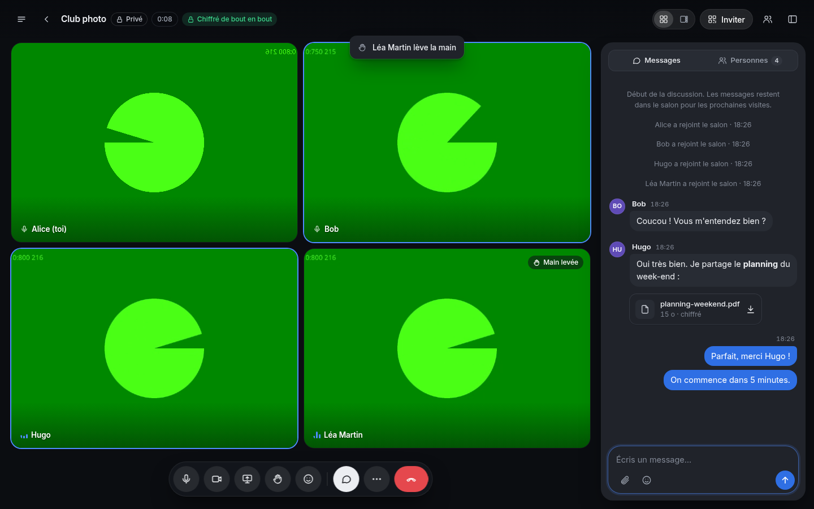
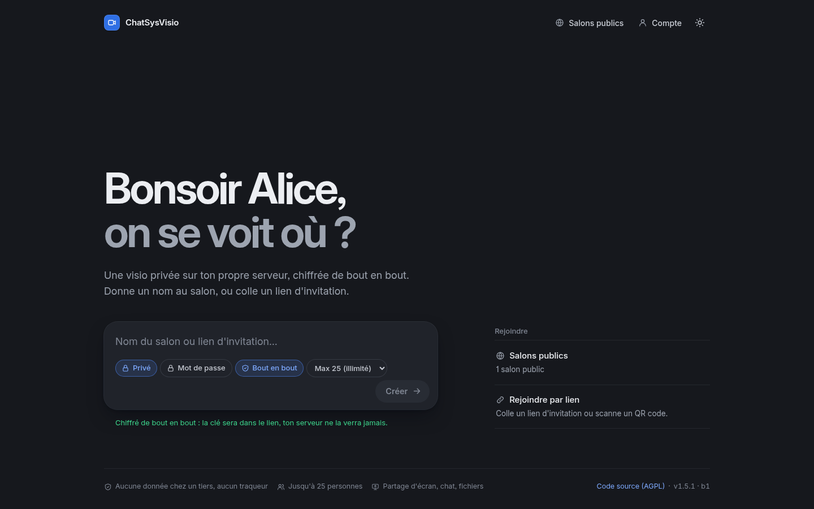
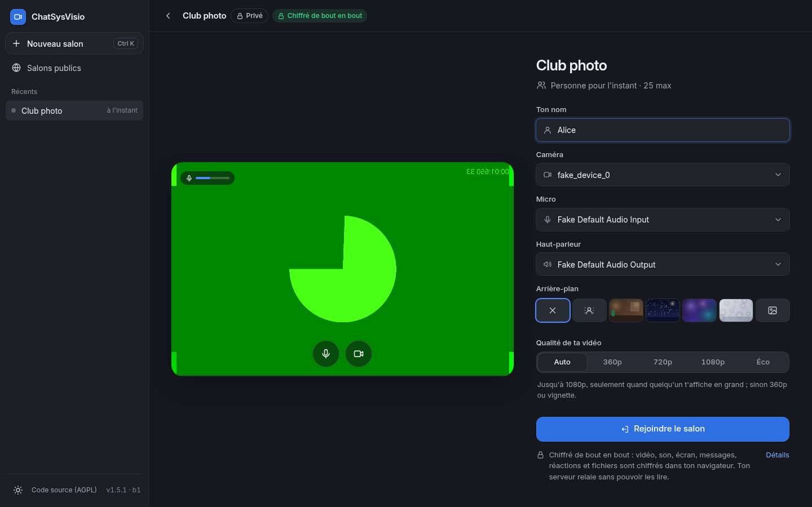
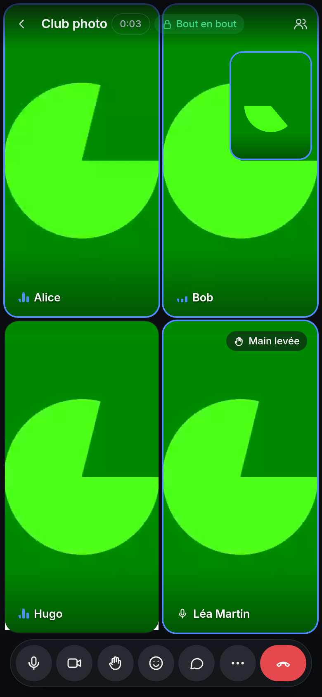

# ChatSysVisio

*English · [Français](README.fr.md)*


Self-hosted **video calls + chat** (French UI) for up to **25 people per room**, running over a **single HTTPS port (443)**:
pages, API, video and audio all go through WebSocket — no UDP, no TURN server. A fork of
[Camus](https://github.com/camuschat/camus) (AGPL-3.0), rewritten in Node.js with vanilla JavaScript.



## Features

- Public or private rooms, optional password, participant limit.
- **End-to-end encryption** for private rooms (video, audio, screen, chat, files); the key stays in the link fragment.
- WebCodecs video up to **1080p** (VP8 / H.264, JPEG fallback), speaker view, screen sharing, picture-in-picture.
- Background **blur / replacement** (MediaPipe, in the browser), chat with Markdown, reactions, files and images.
- **Microphone processing** (1.6): noise suppression (RNNoise, WebAssembly, local), compressor and de-esser, each switchable on its own, applied live.
- **Autotune** (1.8): pulls singing to the nearest note (chromatic or a major / minor key), correction speed from natural to “robot”, live note display; computed on the device, 13 ms latency, sound untouched outside sung voice.
- **Voice isolator** (1.9): keeps your voice and removes music, TV, noise and most of the voices behind you while you pause (DeepFilterNet3 model run on the device, WebAssembly, ≈ 11 MB downloaded once from your own server, only when switched on); adjustable strength, about 39 ms latency, includes noise suppression. It does not know *who* is speaking: a voice as loud as yours goes through while you talk.
- **Shared whiteboard** (1.7): sketch together, shown to everyone like a screen share; pen with pressure, shapes, eraser, per-person undo, PNG export, owner lock; vector strokes, end-to-end encrypted in private rooms.
- **Read receipts** (1.7): “Vu par …” under your own messages, sent only when the message was really on screen.
- Installable PWA, dark / light themes, mobile layout, QR-code invitations generated locally.
- LAN-only **admin console** (password + TOTP), optional user accounts, nightly backups.
- Strict security headers (CSP without `unsafe-inline`, HSTS, COOP/COEP) — **A+** on WebGuardian.

| Home | Lobby | Mobile |
|---|---|---|
|  |  |  |

## Quick install (offline standalone package, Debian 13, no Docker)

The release archive bundles the code, its dependencies, the Inter font, MediaPipe and its model, and an official
**Node.js 24** build (linux-x64 and linux-arm64, SHA256-checked). No network access is needed during installation.

```bash
sha256sum -c chatsysvisio-1.9.0.tar.gz.sha256
tar -xzf chatsysvisio-1.9.0.tar.gz && cd chatsysvisio-1.9.0
sudo bash install.sh        # asks for the public URL and the reverse proxy IP
```

Then publish it behind a reverse proxy (Nginx Proxy Manager: enable *Websockets Support*, leave *HSTS* off) and
create the admin account with `sudo chatsysvisio-admin create-admin`.

Full manual (French): [`docs/MANUEL.md`](docs/MANUEL.md) · Architecture: [`docs/ARCHITECTURE.md`](docs/ARCHITECTURE.md).

## Development

```bash
npm ci && npm run vendor
npm start                 # http://localhost:8790
npm test                  # unit tests
npx playwright test       # end-to-end tests (Chrome)
bash scripts/standalone.sh  # build the offline package
```

## License

GNU **AGPL-3.0-or-later** — see [`LICENSE`](LICENSE) and [`NOTICE.md`](NOTICE.md).
ChatSysVisio is a fork of Camus © Morgan Robertson and contributors. The running server offers its exact source code at
`/source.tar.gz` (AGPL § 13).
