# ChatSysVisio — Manuel d'installation et d'utilisation

*Version 1.13.1 · licence AGPL-3.0-or-later · fork de Camus*


## 1. Présentation

ChatSysVisio est une **visio + messagerie auto-hébergée**, en français, pour **25 personnes par salon**. Tout passe par
**un seul port, HTTPS 443** (pages, API, vidéo et son en WebSocket) : pas d'UDP, pas de serveur TURN, aucun autre port à
ouvrir. Aucune donnée n'est confiée à un tiers, aucun traqueur.

Fonctions principales :

- salons **publics** (listés sur la page « Salons publics », **supprimés automatiquement 10 min après le départ du dernier
  participant**) ou **privés** (accessibles par lien), **mot de passe** facultatif, limite de participants ;
- **chiffrement de bout en bout** des salons privés : vidéo, son, écran, chat, réactions et fichiers sont illisibles pour
  le serveur ; la clé est dans le lien (`#k=…`), jamais envoyée au serveur ;
- vidéo jusqu'en **1080p** (Auto / 360p / 720p / 1080p / Éco), HD envoyée seulement à qui l'affiche en grand ;
- mosaïque paginée ou **mode orateur**, partage d'écran, **tableau blanc partagé** (croquis à plusieurs), **vidéo YouTube
  regardée ensemble** (lecture synchronisée, volume propre à chacun), plein écran, image dans l'image ;
- **flou** et **arrière-plans** (détourage MediaPipe exécuté dans le navigateur), **rehaussement faible lumière**
  (éclaircissement et débruitage de l'image sur la carte graphique) ;
- **traitement du micro** : réduction de bruit (RNNoise), **autotune**, compresseur et dé-esseur, activables séparément ;
- chat : réponses, Markdown, réactions, **fichiers et images**, « … écrit », **« Vu »** (accusés de lecture) ; main levée,
  réactions ;
- invitation par lien ou **QR code** (généré localement), appli installable (PWA), thème sombre / clair, mobile ;
- **administration** (réseau local seulement, mot de passe + **TOTP**) ; **comptes** utilisateurs facultatifs.

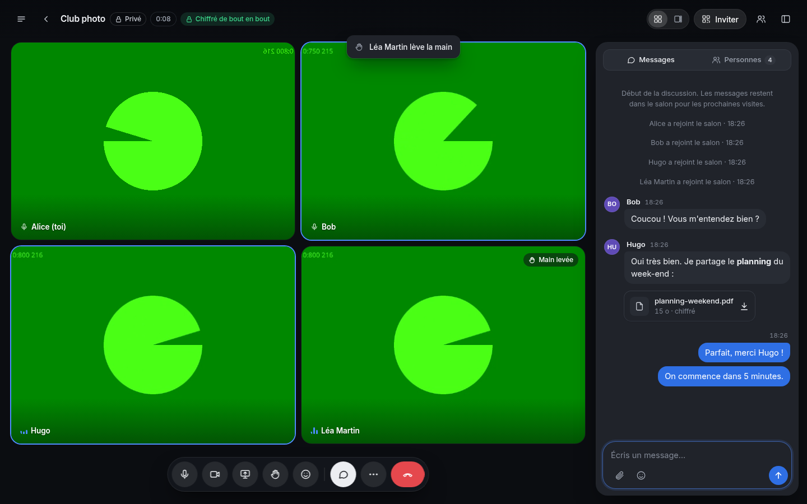

## 2. Prérequis

| Élément | Recommandation |
|---|---|
| Hôte | Proxmox VE (ou toute machine Debian 13) |
| Conteneur | CT LXC **Debian 13 (trixie)**, **non privilégié**, 2 vCPU, 1 Go RAM, 8 Go disque (25 personnes) |
| Réseau | IP fixe sur le LAN (exemple : `10.0.0.20`) |
| Proxy | **Nginx Proxy Manager** (NPM) avec un certificat Let's Encrypt |
| DNS | un nom public (exemple : `chat.example.com`) pointant vers votre IP publique |
| Routeur | port **443** redirigé vers NPM (et 80 pour Let's Encrypt) — jamais le port 8790 du CT |
| Navigateurs | Chrome / Edge / Brave, Firefox, Safari (macOS, iPhone, iPad), Chrome Android — HTTPS obligatoire |

Le paquet autonome n'a besoin **d'aucun accès Internet** pendant l'installation : il contient le code, ses dépendances,
la police Inter, MediaPipe et son modèle, et **Node.js 24 officiel** (linux-x64 et linux-arm64, empreinte SHA256 vérifiée).

## 3. Installation autonome pas à pas (CT Proxmox)

### 3.1 Créer le CT

1. Proxmox → **Create CT** : décocher rien de spécial, laisser **Unprivileged container** coché ; *nesting* inutile.
2. Template : `debian-13-standard` ; disque 8 Go ; 2 cœurs ; 1024 Mo de RAM.
3. Réseau : IP statique, ex. `10.0.0.20/24`, passerelle `10.0.0.1`.
4. Démarrer le CT, ouvrir la console (ou `ssh root@10.0.0.20`).

### 3.2 Copier et vérifier l'archive

Depuis votre poste :

```bash
V=1.13.1      # version téléchargée (dernière release du dépôt)
scp chatsysvisio-$V.tar.gz chatsysvisio-$V.tar.gz.sha256 root@10.0.0.20:/root/
```

Sous Windows, WinSCP ou `pscp` (PuTTY) font la même chose. Dans le CT :

```bash
cd /root
V=1.13.1                                          # même version que ci-dessus
sha256sum -c chatsysvisio-$V.tar.gz.sha256        # doit afficher : OK
tar -xzf chatsysvisio-$V.tar.gz
cd chatsysvisio-$V
sha256sum -c --quiet SHA256SUMS                     # intégrité de chaque fichier (aucune sortie = OK)
```

### 3.3 Lancer l'installation

```bash
bash install.sh
```

Questions (Entrée = valeur proposée) :

| Question | Exemple |
|---|---|
| Adresse publique | `https://chat.example.com` |
| IP de Nginx Proxy Manager | `10.0.0.10` |
| N'accepter que NPM | `o` (recommandé) |
| Port local | `8790` |
| Création de salon anonyme | `o` |
| Résumé par un assistant local (Ollama) | `n` |

Sans questions :

```bash
NONINTERACTIVE=1 PUBLIC_URL=https://chat.example.com NPM_IP=10.0.0.10 bash install.sh
```

Le script :

- vérifie et installe **Node.js embarqué** dans `/opt/chatsysvisio-node` (aucun paquet téléchargé) ;
  `USE_SYSTEM_NODE=1 bash install.sh` utilise à la place `nodejs` des dépôts Debian (nécessite Internet) ;
- crée l'utilisateur système `chatsysvisio` (sans shell), la configuration `/etc/chatsysvisio/chatsysvisio.env` (0600),
  les données `/var/lib/chatsysvisio` ;
- copie le code dans `/opt/chatsysvisio` (lecture seule pour le service) ;
- installe les services `chatsysvisio.service` (durci : utilisateur dédié, système en lecture seule…), la sauvegarde
  nocturne `chatsysvisio-backup.timer` et la CLI `chatsysvisio-admin` ;
- démarre le service et vérifie `/healthz` ; propose de créer l'administrateur.

Contrôle : `systemctl status chatsysvisio` puis `curl -s http://127.0.0.1:8790/healthz` → `{"ok":true,…}`.

> Node embarqué : il n'est pas mis à jour par `apt`. Pour suivre les correctifs de sécurité de Node, installez la
> version suivante du paquet ChatSysVisio, ou passez à `USE_SYSTEM_NODE=1` (Node 20 de Debian, mis à jour automatiquement).

## 4. Nginx Proxy Manager et DNS

### 4.1 DNS

Chez votre registraire : un enregistrement **A** (et **AAAA** si IPv6) `chat.example.com` → votre IP publique.
Recommandé : un enregistrement **CAA** `0 issue "letsencrypt.org"`.

### 4.2 Proxy Host

**Hosts → Proxy Hosts → Add Proxy Host**

| Onglet | Champ | Valeur |
|---|---|---|
| Details | Domain Names | `chat.example.com` |
| | Scheme / Forward Hostname / Port | `http` / `10.0.0.20` / `8790` |
| | Cache Assets | **désactivé** |
| | Block Common Exploits | activé |
| | **Websockets Support** | **activé** (indispensable : la vidéo et le son passent par là) |
| SSL | Certificate | Let's Encrypt (Request a new SSL Certificate) |
| | Force SSL, HTTP/2 | activés |
| | **HSTS Enabled** | **désactivé** : ChatSysVisio envoie lui-même un HSTS conforme (2 ans, includeSubDomains, preload) |

Onglet **Advanced** :

```nginx
proxy_read_timeout 3600s;
proxy_send_timeout 3600s;
proxy_buffering off;
client_max_body_size 12m;
```

N'ajoutez **aucun en-tête de sécurité** dans NPM : l'application les envoie tous (CSP, HSTS, COOP/COEP…) ; des doublons
feraient baisser la note.

Vérification : `https://chat.example.com/healthz`.

## 5. Première connexion et administrateur (TOTP)

1. Ouvrez `https://chat.example.com` : saisissez votre prénom, créez un salon. Autorisez caméra et micro.
2. Créez l'administrateur **dans le CT, en root** :

   ```bash
   chatsysvisio-admin create-admin
   ```

   - mot de passe de 12 caractères minimum (saisie masquée) ;
   - un **QR code** s'affiche dans le terminal : scannez-le avec une application TOTP (Aegis, 2FAS, Google
     Authenticator, 1Password…) ;
   - notez hors ligne les **10 codes de secours** à usage unique ;
   - saisissez un premier code pour confirmer.
3. L'administration est à `https://chat.example.com/admin/` **depuis le réseau local uniquement** (les autres reçoivent un
   404). Connexion : identifiant + mot de passe + code à 6 chiffres.

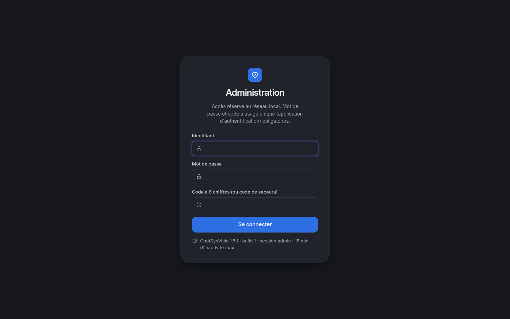

## 6. Tunnel SSH vers l'administration

Depuis l'extérieur (ou si `/admin` est bloqué dans NPM), passez par un tunnel SSH : l'administration accepte HTTP en
boucle locale.

**OpenSSH** (Linux, macOS, Windows 10+) :

```bash
ssh -L 8790:127.0.0.1:8790 root@10.0.0.20
```

puis ouvrez `http://127.0.0.1:8790/admin/` sur votre poste.

**PuTTY** (Windows) :

1. *Session* : Host Name `10.0.0.20`, port 22.
2. *Connection → SSH → Tunnels* : Source port `8790`, Destination `127.0.0.1:8790`, **Local**, bouton **Add**.
3. Revenez à *Session*, enregistrez, **Open**, connectez-vous.
4. Ouvrez `http://127.0.0.1:8790/admin/`.

Pour atteindre le CT depuis Internet, passez par un VPN ou un bastion : n'exposez jamais le port 22 directement.

## 7. Utilisation (participants)

### Salons

- **Créer** : page d'accueil → nom du salon → options **Privé / Public**, **Mot de passe**, **Bout en bout**, limite de
  participants → **Créer**.
- **Public** : listé sur « Salons publics », chiffré jusqu'au serveur (TLS) seulement, c'est affiché. Depuis la 1.12, un
  salon public **sans mot de passe** est **supprimé automatiquement 10 minutes après le départ du dernier participant**
  (voir ci-dessous).
- **Privé** : seul le lien y mène. **Bout en bout** activé par défaut : partagez **le lien complet** (bouton
  « Copier le lien » ou QR code). Sans la partie `#k=…`, on voit « Lien incomplet ».
- **Mot de passe** : demandé à l'entrée, en plus du lien.
- Le **cadenas** dans l'en-tête affiche l'état du chiffrement et un **code de sécurité** à comparer à voix haute.

#### Suppression automatique des salons publics vides (1.12)

- Dès qu'un salon public n'a **plus personne de connecté**, un compte à rebours de **10 minutes** démarre
  (`PUBLIC_ROOM_IDLE_TTL_MIN`, voir §10). Si quelqu'un revient avant la fin, le salon est conservé et le compte à
  rebours repartira de zéro au prochain départ. Un salon public créé mais jamais rejoint suit la même règle.
- À la fin du délai, le salon est **détruit** : retiré de « Salons publics », historique du chat effacé
  (`messages/<id>.jsonl`), pièces jointes effacées (`files/`), entrée retirée de `rooms.json`, autorisations d'accès des
  navigateurs et bannissements de ce salon oubliés. Le tableau blanc, les « Vu » et l'état de l'appel ne sont gardés
  qu'en mémoire et disparaissent déjà dès que le salon se vide. Le **nom redevient libre** : on peut recréer un salon
  du même nom, qui repart vide. L'événement est noté dans le **Journal** de l'administration (type « Salons »).
- **Redémarrage** du service : le début du vide est enregistré ; un salon déjà vide garde son délai restant (supprimé dès
  le démarrage s'il a expiré pendant l'arrêt) ; un salon qui était occupé au moment de l'arrêt a 10 minutes pour être
  rejoint.
- Affichage : sur « Salons publics », une carte vide indique « Vide · supprimé dans N min s'il reste vide » ; la salle
  d'attente d'un salon public le rappelle (« Ce salon public sera supprimé 10 min après le départ du dernier
  participant… ») ; l'administration affiche le temps restant dans « Tous les salons ».
- **Non concernés** : les salons **privés** et les salons **protégés par mot de passe** (même publics) ; ils restent
  supprimés après **30 jours sans activité** (`ROOM_TTL_DAYS`), comme avant.

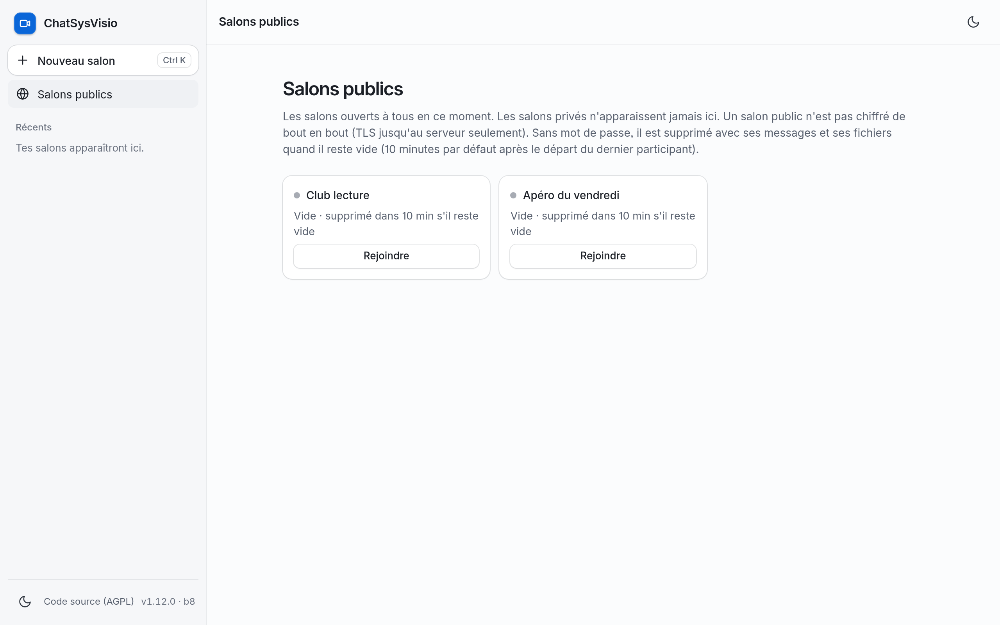

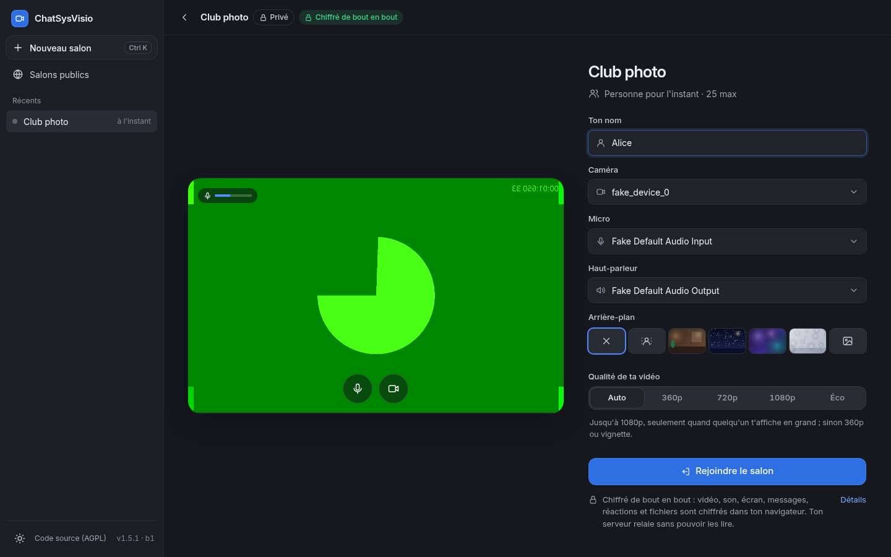

### Salle d'attente

Aperçu caméra, niveau du micro, choix de la caméra, du micro et du haut-parleur, **traitement du micro**, **flou** ou
**arrière-plan** (images fournies ou la vôtre), puis **Rejoindre**.

### Traitement du micro (1.6, autotune 1.8, isolateur de voix 1.9)

Cinq interrupteurs **indépendants**, sous « Traitement du micro » : dans la salle d'attente, et pendant l'appel par le
menu « … » → **Traitement du micro** (ou « Arrière-plan et appareils »). Ils sont enregistrés dans le navigateur et
s'appliquent **à chaud**, sans couper le micro ni l'appel. Tous sont coupés par défaut.

| Réglage | Effet | Quand l'activer |
|---|---|---|
| **Réduction de bruit** | RNNoise (réseau de neurones de Xiph/Mozilla, WebAssembly exécuté sur l'appareil) : retire souffle, ventilation, clavier, bruit de rue. Mesuré : bruit large bande −21 dB, voix conservée | pièce bruyante, PC portable qui ventile |
| **Isolateur de voix** (1.9) | garde **ta voix** et retire musique, télé, bruits et la plupart des voix en arrière-plan **pendant tes pauses** (voir ci-dessous). Inclut la réduction de bruit | musique ou télé dans la pièce, open space, café |
| **Autotune** (1.8) | ramène le chant sur la note juste la plus proche (voir ci-dessous). Hors voix chantée (silence, bruit, consonnes), le son passe intact | chanter, karaoké, effet « robot » |
| **Compresseur** | rapproche les passages faibles et forts (seuil −26 dB, ratio 4:1, attaque 4 ms, relâchement 180 ms, compensation +2 dB) | voix qui varie, on s'éloigne du micro |
| **Dé-esseur** | atténue seulement la bande 5–9 kHz quand elle domine (jusqu'à −14 dB) : les « s » et « ch » sifflants. Hors sifflante, le son est intact | micro-casque ou micro très brillant |

Chaîne : micro → **isolateur de voix** *ou* réduction de bruit → **autotune** → compresseur → dé-esseur → encodeur Opus
(puis chiffrement de bout en bout). Si l'isolateur et la réduction de bruit sont allumés tous les deux, l'isolateur
**remplace** RNNoise : il réduit déjà le bruit, donc il n'y a pas de double traitement. La réduction de bruit affiche
alors « incluse dans l'isolateur ». Elle reprend toute seule si l'isolateur est coupé ou indisponible. Tout est calculé localement : rien ne part vers un service extérieur. La réduction de bruit **légère** du navigateur
(`noiseSuppression` de getUserMedia, avec l'annulation d'écho) reste toujours active ; l'interrupteur ajoute RNNoise,
bien plus efficace. Sous les interrupteurs, la réduction en cours s'affiche en direct (« Compression : −4,0 dB »).
« Infos techniques » indique l'état réel de chaque étage.

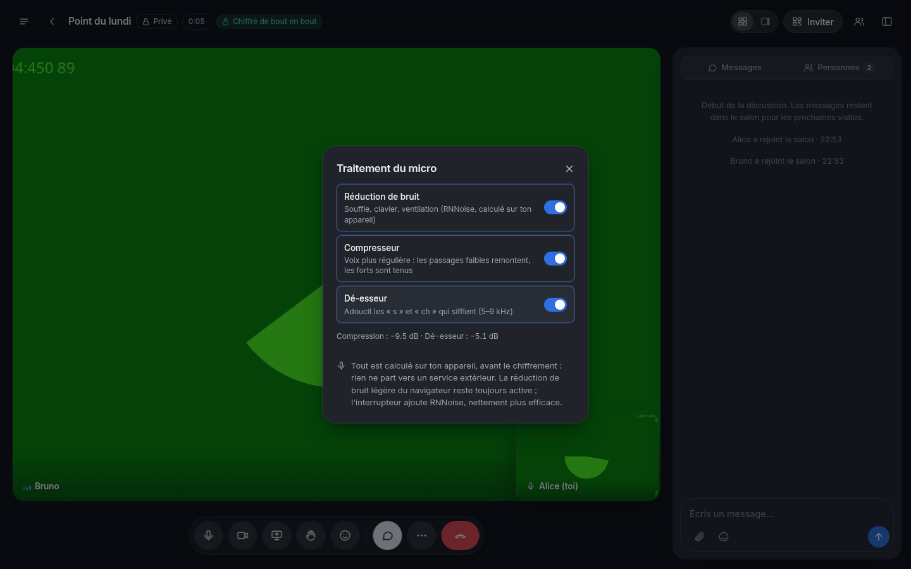

**Pourquoi cet ordre ?**

- L'**isolateur** (ou la réduction de bruit) vient en premier. Le modèle a besoin du son brut du micro, et chaque étage
  suivant travaille ensuite sur une voix propre. Placé après le compresseur, il recevrait un fond déjà remonté par
  celui-ci.
- L'**autotune** vient juste après. Il détecte la hauteur bien mieux sur une voix débruitée (le souffle et la
  ventilation brouillent la période). Il passe aussi **avant le compresseur** : les variations de gain du compresseur
  ne perturbent pas la détection, et le compresseur égalise ensuite le niveau du chant corrigé.
- Le **dé-esseur** vient en dernier. Il traite les sifflantes qui restent, y compris celles que le compresseur a fait
  ressortir, juste avant l'encodeur.

Coût processeur (mesuré sur PC, `node scripts/micfx-bench.mjs`, Chrome) : réduction de bruit ≈ 1,5 % d'un cœur,
autotune ≈ 1,3 % (voix chantée en continu, cas le plus coûteux), compresseur 0,3 %, dé-esseur 0,2 %, les quatre
ensemble ≈ 3,2 %, **isolateur ≈ 3,4 %**, les cinq ensemble ≈ 3,6 % (Firefox 3,5 / 4,3 %, Safari-WebKit 3,1 / 3,7 %).
Sur téléphone, comptez quelques % d'un cœur pour les quatre premiers, et environ 10 à 20 % d'un cœur pour l'isolateur
(estimation, non mesurée sur un appareil réel). Limites : RNNoise est prévu pour 48 kHz ; si le
navigateur tourne à 44,1 kHz (certains Mac, Firefox), l'effet est un peu moindre et c'est signalé. Sans WebAssembly,
l'interrupteur de la réduction de bruit affiche « indisponible », et les autres étages continuent de fonctionner.

#### Isolateur de voix (1.9)

Allumez **Isolateur de voix** : le réglage **Intensité** apparaît dessous, de **0 · légère** à **100 · forte**
(60 par défaut). Il est enregistré dans le navigateur et s'applique à chaud.

Le modèle est **DeepFilterNet3**, un réseau de neurones libre (MIT / Apache-2.0) exécuté **sur l'appareil** en
WebAssembly. Il se télécharge **une seule fois** depuis votre propre serveur (≈ 10,7 Mo compressés en brotli, 12,7 Mo
en gzip, sans CDN), et seulement si l'interrupteur est allumé. La ligne sous le réglage indique où il en est :

| Message | Signification |
|---|---|
| « Le modèle (≈ 11 Mo, une seule fois) se télécharge quand tu rejoins l'appel. » | salle d'attente, rien n'est encore chargé |
| « Téléchargement du modèle… 42 % (une seule fois) » + barre de progression | téléchargement en cours ; la réduction de bruit (si allumée) fonctionne pendant ce temps |
| « Préparation du modèle… » puis « Démarrage du modèle… » | compilation puis démarrage (≈ 0,5 s) |
| « Actif · 39 ms de latence · voix de second plan −18 dB · réduction de bruit incluse » | en marche ; la valeur en dB indique ce que la porte retire à cet instant |
| « Isolateur indisponible : … Le son passe sans isolation. » | navigateur sans WebAssembly SIMD, téléchargement impossible ou appareil trop lent |

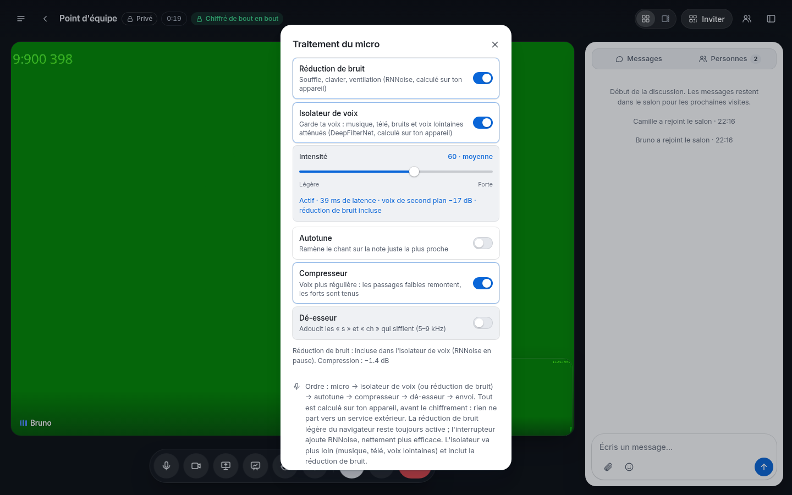

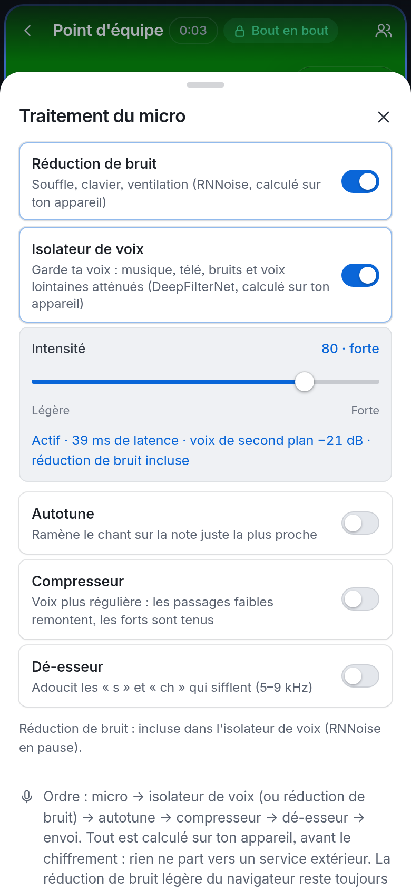

Ce qu'il fait **vraiment** :

- **Musique, télé, bruits** (ventilation, clavier, vaisselle, rue) : retirés presque entièrement. Mesuré sur des
  mélanges de synthèse : musique −37 à −39 dB pendant vos pauses, et votre voix ressort à son niveau (écart < 0,1 dB).
- **Autres voix** : le modèle garde *toute* parole, car il ne sait pas *qui* parle. Une **porte de proximité** s'y
  ajoute. Elle suit le niveau de **votre** voix, la plus forte puisque vous êtes près du micro, et atténue pendant vos
  pauses ce qui est nettement plus faible : collègue à l'autre bout de la pièce, télé, voix réverbérée. Mesuré :
  voix lointaine −25 à −35 dB dans les pauses quand elle est réverbérée, et pour une voix sèche 14 dB plus faible que
  la vôtre −4 / −10 / −21 dB selon l'intensité 0 / 60 / 100.
- **Pendant que vous parlez**, la porte reste ouverte. Une voix derrière vous passe alors en même temps que la vôtre,
  seulement un peu masquée.
- Une personne **juste à côté de vous**, qui parle aussi fort que vous, n'est pas retirée. Il faudrait un modèle qui
  reconnaisse votre voix (« locuteur cible »), et il n'en existe pas aujourd'hui sous forme libre, légère et en temps
  réel dans un navigateur.

Plus l'intensité est forte, plus le fond est retiré, mais plus les fins de mots très douces de votre voix risquent
d'être coupées : à 100, environ 9 % de vos trames de parole sont atténuées de plus de 3 dB, contre 7 % pour le modèle
seul. 60 est un bon compromis.

Latence ajoutée : **39 ms** à 48 kHz (40 ms à 44,1 kHz), fixe et mesurée dans Chrome, Firefox et Safari (WebKit). Elle
remplace les ≈ 27 ms de RNNoise quand les deux sont allumés.

Limites :

- au démarrage du modèle (une fois par appel), un petit accroc de son d'environ 0,5 s est possible ;
- un téléphone ancien peut être trop lent. L'isolateur se met alors en pause tout seul (« appareil trop lent »), le
  son passe sans isolation, et l'isolation native du navigateur est utilisée si l'appareil en propose une ;
- il faut un navigateur avec WebAssembly SIMD : Chrome / Edge 91+, Firefox 89+, Safari 16.4+ (iPhone iOS 16.4+) ;
- **chant** : le modèle est entraîné sur la parole. Il peut prendre une note longue et tenue pour un bruit et la
  retirer. Sur la voix chantée de synthèse des tests, c'est −12 dB à l'intensité 0 et presque tout à 60 ; une vraie voix
  n'a pas été testée. **Pour chanter (autotune), coupez l'isolateur** et gardez la réduction de bruit. Un avertissement
  s'affiche quand les deux sont allumés ;
- extrait d'écoute : `isolateur-demo-avant.wav` / `isolateur-demo-apres.wav`, une voix de synthèse avec de la musique
  puis une voix lointaine, sans aucun enregistrement réel.

#### Autotune (1.8)

Allumez **Autotune** : ses réglages apparaissent juste en dessous. Quand il est coupé, ils sont masqués.

| Réglage | Effet |
|---|---|
| **Vitesse de correction** | de **0 · naturelle** (la note glisse doucement vers la note juste, le vibrato est conservé) à **100 · robot** (saut instantané d'une note à l'autre, l'effet « T-Pain »). 50 par défaut |
| **Tonalité** | **Chromatique** (par défaut : les 12 notes) ou une tonique de **Do** à **Si** |
| **Majeur / Mineur** | gamme utilisée quand une tonalité est choisie (masqué en chromatique) |

Pendant l'appel, la ligne sous les réglages affiche **en direct** la note chantée, la note visée et la correction
appliquée, par exemple « Sol♯ 3 → La 3 · 431 Hz · correction +38 cents ». Les notes sont nommées à la française
(La 3 = 440 Hz). Les réglages s'appliquent à chaud et sont enregistrés dans le navigateur avec les interrupteurs.

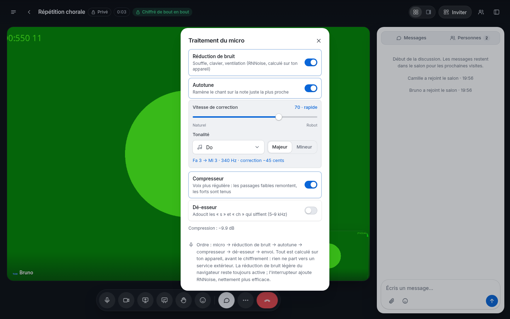

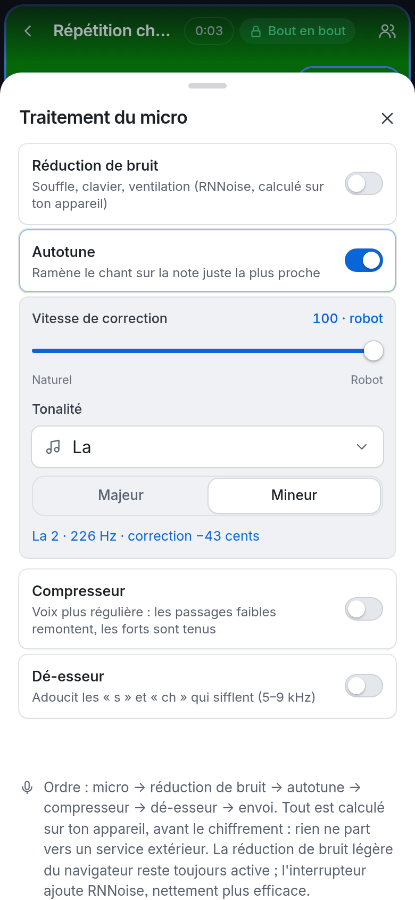

Fonctionnement :

- la hauteur est détectée par la méthode **YIN**, sur le son sous-échantillonné, toutes les 5 ms ;
- la voix est transposée **sans changer sa durée**, par fenêtres calées sur la période de la voix (famille PSOLA) ;
- hors voix chantée (silence, bruit, souffle, consonnes « s », « f », « ch »), le son ressort **à l'identique**,
  seulement retardé : aucun artefact ;
- latence ajoutée : **13 ms**, fixe, mesurée dans Chrome, Firefox et Safari (WebKit) ;
- tout est calculé sur l'appareil (AudioWorklet servi par le serveur, sans CDN, CSP inchangée), sur PC comme sur
  Android et iPhone.

Mesures : une sinusoïde à 450 Hz ressort à 440,00 Hz en chromatique, et une à 470 Hz ressort à 493,88 Hz (Si) en
Do majeur. Sur la voix de synthèse de démonstration, chantée faux de 36 cents en moyenne, l'écart tombe à 0,4 cent
en mode robot.

Limites :

- l'autotune suit **une seule voix** : deux personnes qui chantent ensemble, ou un instrument derrière, le font
  hésiter. Il laisse alors passer le son sans le corriger ;
- plage de 70 à 1 000 Hz, environ du Ré 1 au Si 5 ;
- une voix très soufflée ou chuchotée n'est pas corrigée, car elle n'a pas de hauteur ;
- au-delà d'environ 3 demi-tons de correction, le timbre change un peu (les formants suivent la transposition) ;
- sans AudioWorklet (navigateur très ancien), l'interrupteur affiche « indisponible » et le son passe sans
  correction. Les navigateurs actuels le gèrent tous.

### Réglages de la caméra et qualité d'image (1.10)

Bouton **Réglages de la caméra** dans la salle d'attente (« Image de la caméra ») et dans le menu « … » pendant l'appel.
Tout s'applique à chaud, sans couper la caméra, et reste enregistré dans ce navigateur, **par caméra**.

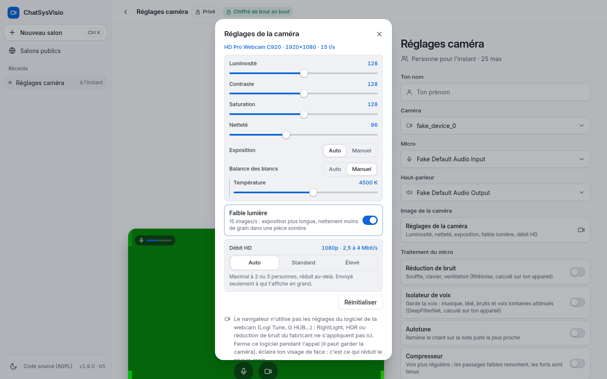

- **Luminosité, contraste, saturation, netteté, exposition (auto / manuelle), balance des blancs (auto / température)** :
  seulement les réglages que la caméra et le navigateur exposent. Chrome et Edge sur ordinateur les donnent pour la
  plupart des webcams (Logitech C920, C922, Brio…) ; Firefox et Safari n'en exposent aucun (le panneau le dit). Une
  valeur jamais touchée reste celle du pilote ; **Réinitialiser** remet les valeurs relevées à la première ouverture.
- **Faible lumière** : la caméra passe à 15 images/s. L'exposition automatique peut alors poser jusqu'à 66 ms par image
  au lieu de 33–41 ms : moins de gain, donc **beaucoup moins de grain** dans une pièce sombre (c'est ce que fait
  RightLight dans le logiciel Logitech). La couche HD suit la caméra à 15 i/s.
- **Débit HD** : *Auto* envoie la 1080p à 4 Mbit/s à 2 ou 3 personnes (720p : 2 Mbit/s), 3,25 Mbit/s jusqu'à 6, puis
  2,5 Mbit/s (débit d'avant la 1.10) ; *Standard* garde toujours 2,5 Mbit/s ; *Élevé* garde toujours 4 Mbit/s. Plafonds
  réglables côté serveur (`VIDEO_1080_MAX_KBPS`, `VIDEO_720_MAX_KBPS`).

**Pourquoi l'image est plus bruitée que dans Logi Tune / G HUB** : l'aperçu du logiciel Logitech montre l'image brute
de la caméra, avec ses traitements propres (RightLight, HDR, réduction de bruit), qui **ne s'appliquent pas au
navigateur** ; ChatSysVisio, lui, compresse l'image (VP8) pour l'envoyer : le grain du capteur coûte très cher en débit
et devient une bouillie à 2,5 Mbit/s. Le plus efficace, dans l'ordre : de la lumière **de face** sur le visage, le mode
**Faible lumière**, une **netteté** un peu plus basse (l'accentuation de la caméra grossit le grain), le débit *Élevé*.
Fermer le logiciel Logitech pendant l'appel : il peut garder la caméra ou lui imposer un autre mode.

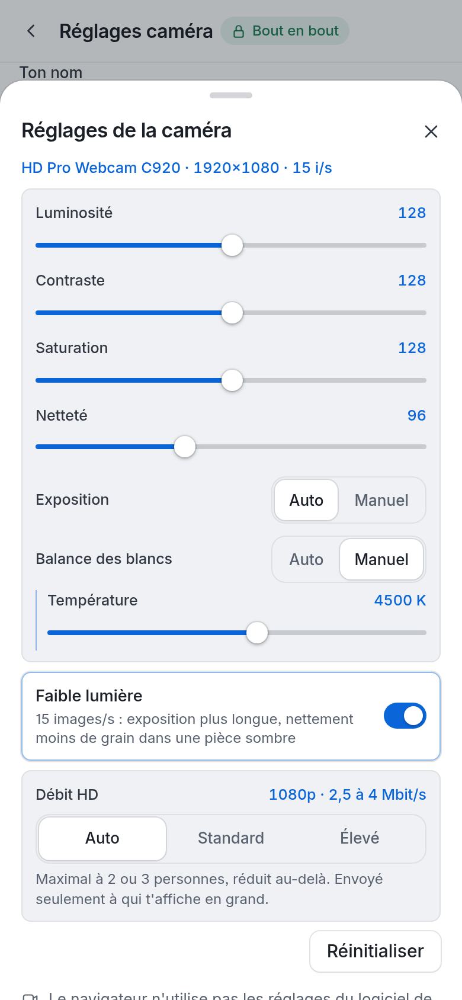

### Rehaussement faible lumière, champ complet, miroir et zoom (1.11)

Dans **Réglages de la caméra** (salle d'attente ou menu « … »), tout s'applique à chaud et reste enregistré dans ce
navigateur.

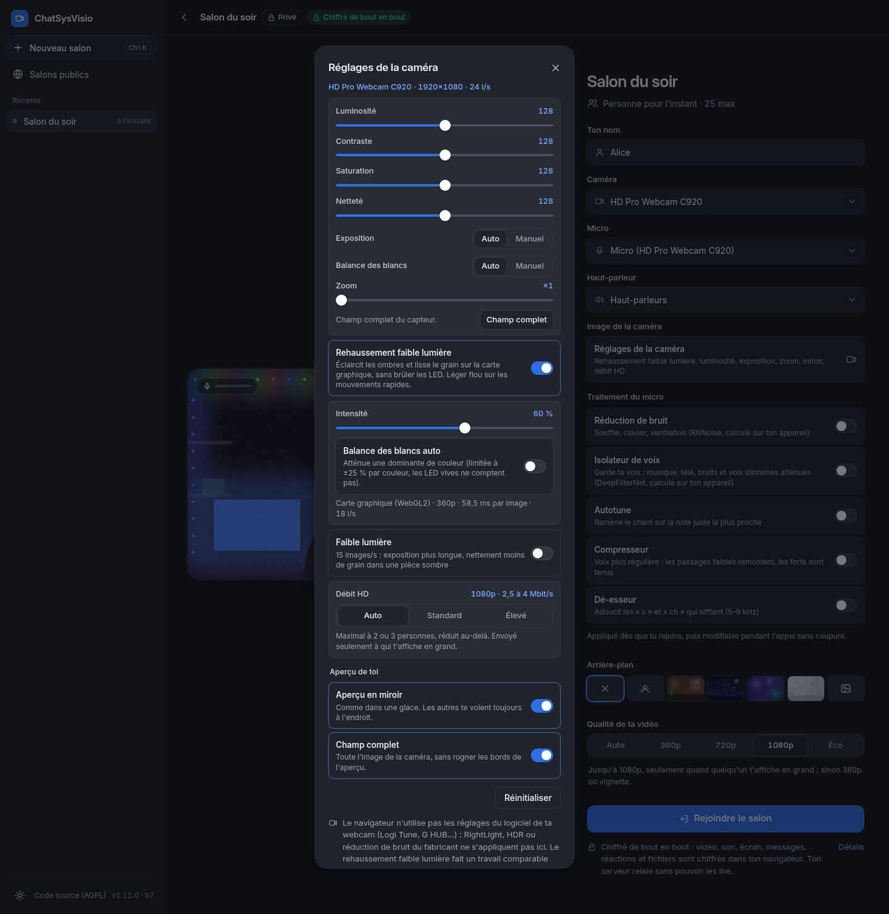

- **Rehaussement faible lumière** (désactivé par défaut) : dans une pièce sombre, éclaircit les ombres et le visage sans
  brûler les LED ni l'écran, et lisse le grain (débruitage dans l'image et d'une image à l'autre, coupé là où ça bouge).
  C'est l'équivalent, dans le navigateur, de ce que fait le logiciel Logitech (RightLight, réduction de bruit). Calculé
  sur la **carte graphique** (WebGL2), avant l'envoi : les autres voient l'image rehaussée. Il se combine avec le flou ou
  l'arrière-plan (le détourage se fait sur l'image déjà éclaircie, ce qui l'aide aussi dans le noir).
  - **Intensité** : 60 % par défaut ; plus haut = plus clair et plus lisse, mais un peu plus « peint ».
  - **Balance des blancs auto** (option) : atténue une dominante de couleur (visage trop orangé), limitée à ±25 % par
    couleur ; les LED vives et l'écran ne comptent pas dans le calcul. Avec un éclairage volontairement coloré, laissez-la
    éteinte.
  - La ligne d'état indique le mode (carte graphique ou simplifié), la définition traitée, le **coût par image** et la
    cadence. Si l'appareil est trop lent (plus de 30 ms par image), le filtre s'allège, puis passe en 720p, puis
    s'arrête avec un message. Sans WebGL2 : mode simplifié (éclaircissement seul, sans débruitage).
- **Champ complet** (oui par défaut) : ton aperçu montre **toute** l'image de la caméra. Avant la 1.11, l'aperçu était
  rogné pour remplir la vignette (−10 % de largeur dans la salle d'attente, jusqu'à −20 % en appel avec le chat ouvert) :
  c'est ce qui donnait un cadrage plus serré que Logi Capture. Désactivé : l'aperçu remplit la vignette, comme avant.
- **Aperçu en miroir** (oui par défaut, caméra avant) : comme dans une glace et comme Logi Capture. Les autres te voient
  toujours à l'endroit (un texte tenu devant la caméra est lisible pour eux).
- **Zoom** : si la caméra le permet, un curseur *Zoom* et un bouton **Champ complet** (zoom minimal). Chrome ne donne le
  zoom qu'avec l'autorisation « utiliser et déplacer vos caméras » : bouton **Régler le zoom**, qui la demande une fois.
  Utile si Logi Tune / G HUB a laissé un zoom enregistré dans la caméra.

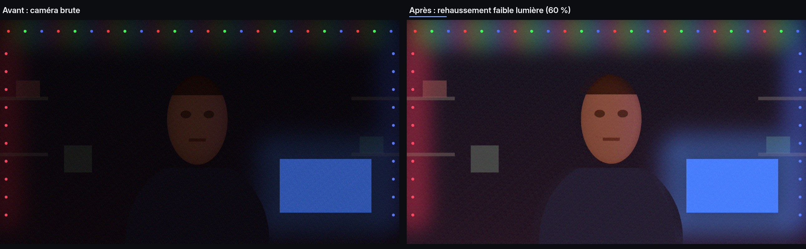

*Image de test (fausse caméra qui imite une pièce sombre éclairée par des LED rouges, vertes et bleues et un écran
bleu), passée dans le vrai traitement, dans Chrome. Gauche : image brute ; droite : rehaussement à 60 %.*

**Mesures** sur cette fausse caméra (1080p, 24 i/s, intensité 60 %) : luminance moyenne **19,7 → 48,9** (sur 255) ;
zone grise fixe 23,5 → 70,8, bruit temporel 4,65 → 2,40, soit un **rapport signal/bruit de 5,1 → 29,5** (≈ 6 fois
moins de grain à luminosité égale) ; aucun pixel brûlé ajouté. À 100 % : signal/bruit 5,1 → 70,5. Coût : la machine
de mesure **n'a pas de carte graphique** (WebGL émulé par le processeur, SwiftShader) : 279 ms par image en 1080p,
127 ms en 720p, 44 ms en 360p — c'est précisément le cas où le garde-fou allège puis coupe. Sur une vraie carte
graphique, même intégrée, le travail (≈ 40 lectures de texture par pixel, 2 Mpixels) se compte en millisecondes ;
la ligne d'état du panneau donne la valeur réelle de ton PC.

**Ce que le navigateur ne peut pas rattraper** face au traitement matériel de Logitech : RightLight et le HDR agissent
**dans la caméra**, sur l'image brute du capteur, avant la compression interne (MJPEG) et avec la maîtrise de
l'exposition et du gain image par image ; le navigateur reçoit une image déjà quantifiée sur 8 bits et compressée. Dans
les noirs profonds, il n'y a plus que quelques niveaux de gris : on peut les éclaircir et lisser le grain, pas
inventer les détails perdus (le résultat peut paraître « peint », surtout à forte intensité). Le débruitage temporel
laisse un léger flou sur les mouvements rapides. Une lampe face au visage reste, de loin, la meilleure correction.

### « Vu » dans le chat (1.7)

Sous **vos propres messages** apparaît une petite mention bleue : **« Vu par Bruno »** si une personne l'a lu,
**« Vu par 3 »** si plusieurs. Survolez-la (ou touchez-la sur mobile) pour afficher la liste des noms. Pour ne pas
encombrer la conversation, la mention n'est affichée que sous le dernier message lu, et sous un message plus ancien
seulement si ses lecteurs sont différents.

Un message ne compte comme **lu** que s'il a réellement été affiché chez l'autre personne : onglet du navigateur au
premier plan, panneau **Messages** ouvert (le tiroir sur mobile) et message visible à l'écran. Recevoir un message
panneau fermé, ou dans un onglet en arrière-plan, ne déclenche rien. Personne ne peut signaler une lecture au nom d'un
autre : le serveur prend toujours le lecteur sur la connexion. Les accusés vivent en mémoire tant que le salon est
occupé ; quand tout le monde est parti, ils sont oubliés (l'historique des messages, lui, reste). Dans un salon chiffré
de bout en bout, l'accusé ne contient que l'identifiant du message, jamais son contenu.

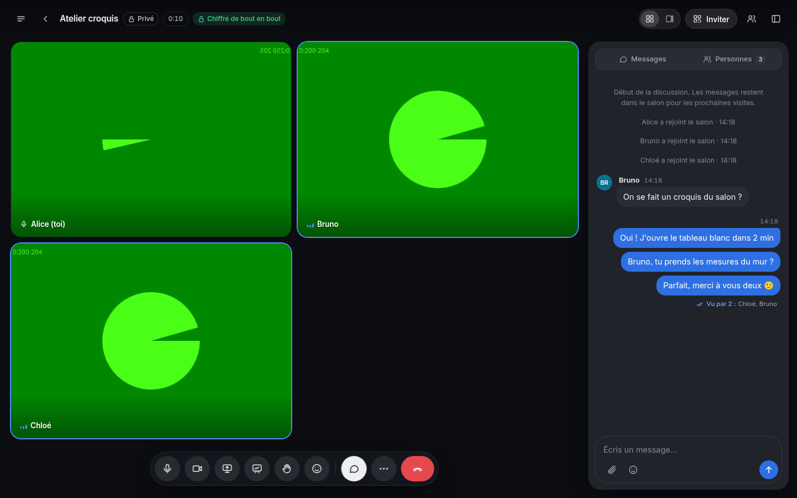

### Tableau blanc (1.7)

Un tableau blanc partagé pour faire des croquis à plusieurs, **comme un partage d'écran** : bouton **Tableau blanc**
dans le dock, juste à droite de « Partager l'écran » (sur mobile : menu « … » → **Tableau blanc**). Dès qu'il est ouvert,
il s'affiche **en grand chez tout le monde** (mode orateur), les caméras passent en vignettes. Double-cliquez sur une
vignette pour l'épingler à sa place ; un clic sur la vignette du tableau le remet en grand.

| Outil | Rôle |
|---|---|
| Stylet | trait à main levée, lissé ; épaisseur variable selon la **pression** avec un stylet (iPad, Surface, tablette Wacom) |
| Ligne, flèche, rectangle, ellipse | formes : appuyer, tirer, relâcher |
| Gomme | efface ce qu'elle touche |
| 5 couleurs, 3 épaisseurs | noir, bleu, rouge, vert, violet ; fin, moyen, épais |
| Annuler / Rétablir | **chacun** annule ses propres traits (Ctrl+Z, Ctrl+Maj+Z), jamais ceux des autres |
| Exporter en PNG | image 1920 × 1080 sur fond blanc, téléchargée par le navigateur |
| Verrouiller | **réservé à la personne qui a ouvert le tableau** : elle seule peut alors dessiner, les autres regardent |
| Tout effacer, Fermer | réservés à la personne qui a ouvert le tableau (avec confirmation) |

Pendant qu'une autre personne dessine, son trait apparaît **en direct** avec une petite étiquette à son nom au bout du
crayon. Qui arrive en cours de route reçoit le dessin complet. Le dessin est **vectoriel** (des coordonnées, pas une
vidéo) : il reste net sur tous les écrans, du téléphone au grand écran, et consomme très peu (quelques Ko par trait).
Il fonctionne à la souris, au doigt (Android, iPhone, iPad : la page ne défile pas pendant le dessin) et au stylet.

Dans un salon **privé ou protégé par mot de passe**, chaque trait est **chiffré de bout en bout** comme le chat : le
serveur ne voit que des données illisibles. Le tableau est conservé en mémoire tant qu'il est ouvert ; il disparaît à
sa fermeture (pensez à **Exporter en PNG**). Si la personne qui l'a ouvert perd la connexion, elle a 20 secondes pour
revenir et le reprendre ; sinon il se ferme.

**Un seul tableau par salon** : c'est un espace commun, comme un tableau dans une salle de réunion ; deux tableaux
partageraient l'attention et l'écran. Il cohabite en revanche avec les partages d'écran (on peut montrer un document et
dessiner à côté), et c'est lui qui prend la grande vue tant que personne n'épingle autre chose.

Limites : 5 000 traits ou 4 Mo de dessin par tableau (au-delà, « Tableau plein » : effacez ou exportez), débit limité
par personne pour protéger le serveur.

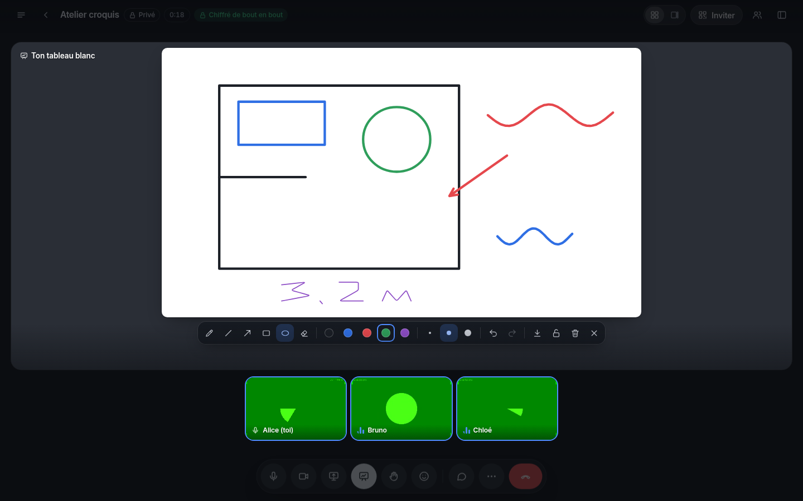

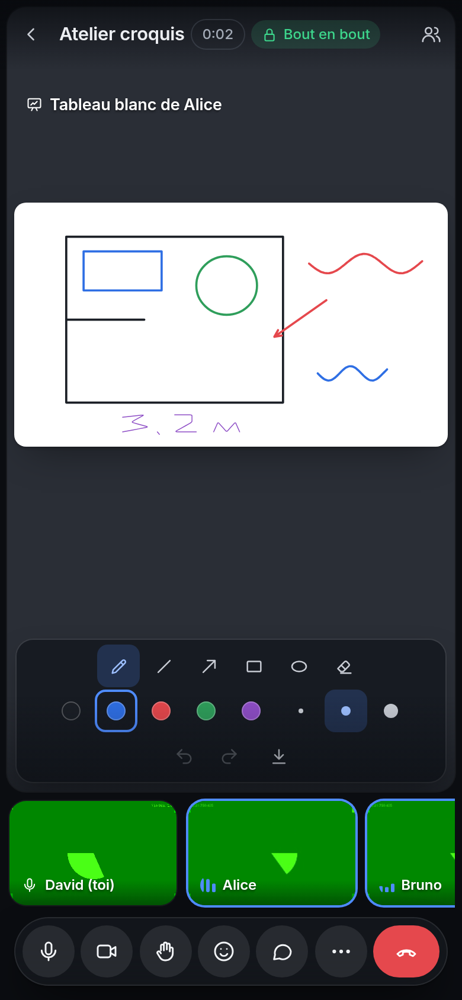

### Vidéo YouTube partagée (1.13)

Pour regarder une vidéo YouTube **ensemble**, comme un partage d'écran mais avec l'image et le son d'origine : bouton
**Partager une vidéo YouTube** dans le dock (à droite du tableau blanc ; sur mobile : menu « … »), collez le lien, puis
**Partager**. La vidéo s'affiche **en grand chez tout le monde**, y compris chez qui arrive en cours de route (même
vidéo, même position, même vitesse, lecture ou pause).

Liens acceptés : `youtube.com/watch?v=…`, `youtu.be/…`, `youtube.com/shorts/…`, `youtube.com/live/…`,
`youtube.com/embed/…`, `m.youtube.com`, `music.youtube.com`, ou l'identifiant seul (11 caractères), avec ou sans
`t=` (`t=90`, `t=1m30s`, `#t=1:30`) pour démarrer à un moment précis. Seul l'**identifiant** de la vidéo circule
(jamais l'adresse collée) ; il est vérifié dans le navigateur et par le serveur.

**Une seule personne partage à la fois** et c'est elle seule qui pilote :

| Qui | Peut |
|---|---|
| La personne qui partage | lecture, pause, avancer / reculer, vitesse (avec les commandes du lecteur YouTube), **Changer** de vidéo, **Arrêter** le partage |
| Les autres | regarder, régler **leur propre volume** ou couper le son **chez eux** ; épingler une autre vignette à la place |

Si quelqu'un d'autre essaie de partager pendant ce temps, il voit « *X partage déjà une vidéo YouTube : il faut d'abord
qu'il arrête son partage.* » (refus appliqué aussi par le serveur). Si la personne qui partage **quitte le salon**, le
partage s'arrête pour tout le monde (un message l'indique dans le chat) et quelqu'un d'autre peut prendre le relais.

**Volume individuel** : la barre sous la vidéo règle le son **uniquement sur votre appareil** ; il n'est jamais envoyé
aux autres ni au serveur, et votre navigateur le retient pour la prochaine fois. Le son de la vidéo s'ajoute à celui de
l'appel ; baisser automatiquement les voix pendant la vidéo n'est pas prévu (idée pour plus tard).

**Synchronisation** : la personne qui partage envoie sa position à chaque action (lecture, pause, saut, vitesse) et
toutes les 4 secondes pendant la lecture. Chez les autres, la vidéo se recale toute seule si elle s'écarte de plus de
**1,5 seconde** (chargement lent, onglet en arrière-plan). Les spectateurs n'envoient rien : pas d'effet d'écho. Dans un
salon **privé ou protégé par mot de passe**, l'identifiant de la vidéo et la position sont **chiffrés de bout en bout**
comme le chat ; dans un salon public, ils passent en clair jusqu'au serveur (TLS).

**Lecture automatique** : les navigateurs (surtout Safari sur iPhone) peuvent refuser de lancer une vidéo **avec le
son** sans geste de votre part. ChatSysVisio la démarre alors **sans le son** et affiche un bouton **Activer le son** ;
sur iPhone, si besoin, touchez une fois la vidéo. La lecture se fait **dans la page** (pas en plein écran forcé) sur
Android comme sur iPhone.

Messages possibles :

| Message | Cause |
|---|---|
| « Le propriétaire de cette vidéo n'autorise pas sa lecture en dehors de YouTube » | vidéo **non intégrable** (erreurs YouTube 101 / 150 : souvent clips musicaux, sport, certaines chaînes) : choisissez-en une autre ; un lien **Ouvrir sur YouTube** reste proposé |
| « Vidéo introuvable » | vidéo supprimée ou privée (erreur 100) |
| « Le lecteur YouTube ne répond pas… bloqueur… » | une extension (uBlock, AdGuard, Brave…) ou un filtre réseau bloque `youtube-nocookie.com` : autorisez-le pour ce site |

Bon à savoir :

- le lecteur est celui de **YouTube** (domaine `youtube-nocookie.com`, sans cookie publicitaire avant la lecture) :
  YouTube voit l'adresse IP de chaque spectateur, comme sur youtube.com ;
- les **publicités** YouTube ne sont pas synchronisées : chacun voit les siennes, puis la vidéo se recale ;
- vidéos réservées aux membres, à âge restreint ou à achat : non lisibles dans le lecteur intégré ;
- l'administrateur peut désactiver la fonction (`YOUTUBE_ENABLED=false` dans le `.env`, voir § 10).

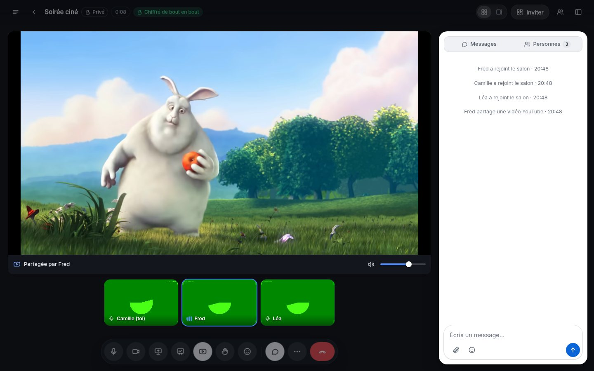

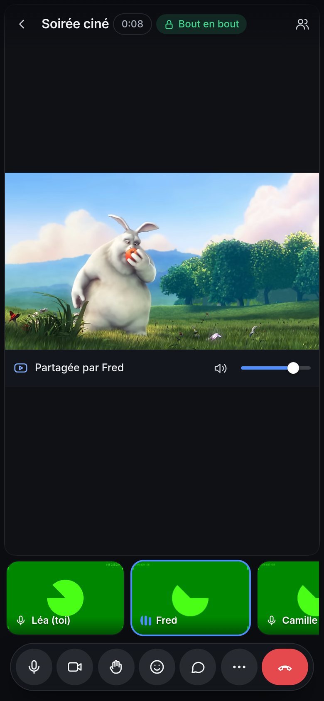

### Pendant l'appel

| Action | Où |
|---|---|
| Micro, caméra, partage d'écran, **tableau blanc**, **vidéo YouTube**, main levée, réactions | dock en bas (sur mobile : partage d'écran, tableau blanc et vidéo YouTube dans le menu « … ») |
| Chat, fichiers et images (10 Mo par défaut) | bouton bulle → onglet Messages ; trombone pour joindre |
| Liste des personnes | onglet Personnes |
| **Mode orateur** / grille | boutons en haut à droite |
| Épingler, plein écran, image dans l'image | menu d'une vignette |
| Qualité (Auto, 360p, 720p, **1080p**, Éco) | menu « … » → Qualité vidéo |
| Flou / arrière-plan, appareils | menu « … » → Arrière-plan et appareils |
| Réduction de bruit, **isolateur de voix**, **autotune**, compresseur, dé-esseur | menu « … » → Traitement du micro |
| Infos techniques (diagnostic) | menu « … » |
| Inviter (lien, QR) | bouton Inviter |

L'en-tête et le dock s'effacent après quelques secondes sans mouvement ; bougez la souris pour les retrouver.


### Mobile

Ouvrez le lien dans Safari (iPhone) ou Chrome (Android). « Ajouter à l'écran d'accueil » installe l'appli. Le chat
et le menu s'ouvrent en tiroir depuis le bas ; glissez vers le bas pour fermer. Flou et arrière-plan sont limités à 720p
sur mobile pour préserver la batterie.

 

## 8. Administration

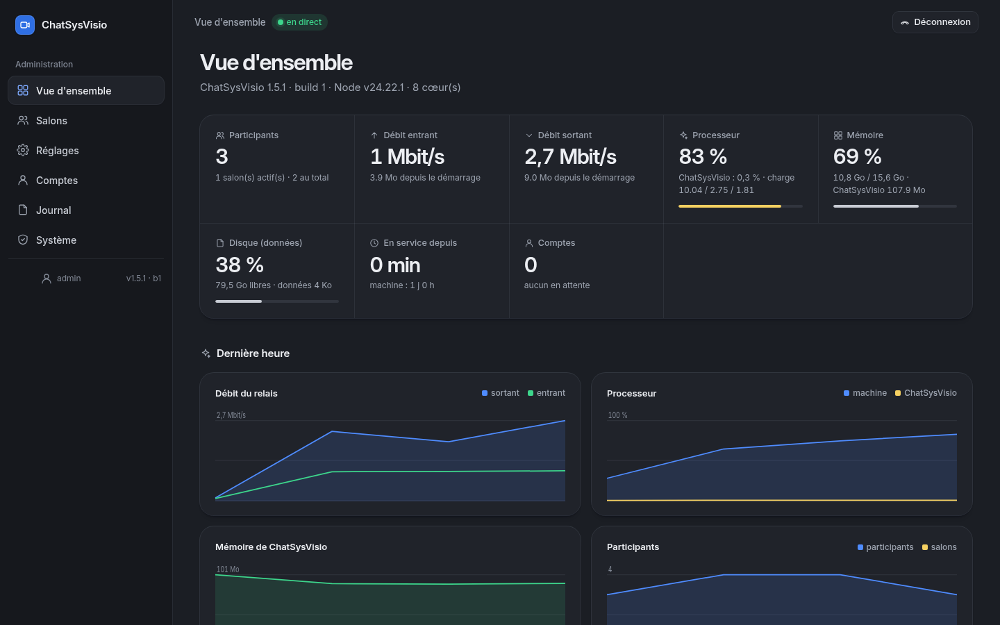

- **Vue d'ensemble** : débits, CPU, RAM, disque, salons et participants, version.
- **Salons** : participants, **exclure** (avec bannissement temporaire), **fermer** ou **supprimer** un salon. Un salon
  public vide affiche « vide · supprimé dans N min » (1.12) ; fermer un salon public lance ce compte à rebours.
- **Réglages à chaud** : création anonyme et code de création, limite par salon, quotas, taille des fichiers,
  mode d'inscription (fermé, ouvert, invitation, validation), création réservée aux comptes, invités.
- **Comptes** : valider, désactiver, supprimer, réinitialiser un mot de passe ; codes d'invitation.
- **Journal** : connexions, blocages, refus, actions admin (sans aucun secret).
- **Système** : sauvegarde immédiate, liste des sauvegardes, mises à jour Debian en attente.

Les réglages modifiés ici sont enregistrés dans `/var/lib/chatsysvisio/settings.json` et ont priorité sur le `.env`.

## 9. Mot de passe, TOTP et déblocage

En root dans le CT (`--user NOM` si l'identifiant n'est pas `admin`) :

| Situation | Commande |
|---|---|
| Lister les administrateurs | `chatsysvisio-admin list` |
| Mot de passe oublié | `chatsysvisio-admin reset-password` |
| Téléphone perdu / nouveau TOTP | `chatsysvisio-admin reset-totp` (nouveau QR + nouveaux codes de secours) |
| Compte bloqué (5 échecs → 15 min) | `chatsysvisio-admin unlock` |
| Supprimer un administrateur | `chatsysvisio-admin delete --user NOM` |

Un code de secours remplace une fois le code TOTP à la connexion.

## 10. Mises à jour et sauvegardes

**Mise à jour** avec un nouveau paquet autonome (la configuration et les données sont conservées) :

```bash
tar -xzf chatsysvisio-<version>.tar.gz && cd chatsysvisio-<version> && bash update.sh
```

Ou avec l'archive de **mise à jour** (même code, sans les tests), depuis la 1.6.0 ou plus récente (ici la 1.13.1, build 10 ; mettre le nom exact de l'archive reçue) :

```bash
MAJ=chatsysvisio-mise-a-jour-1.13.1-b10
sha256sum -c $MAJ.tar.gz.sha256
tar -xzf $MAJ.tar.gz && cd chatsysvisio-maj && bash update.sh
```

Depuis la 1.9.0, l'archive contient déjà le modèle de l'isolateur, précompressé : le serveur n'a rien à télécharger de plus.

`update.sh` sauvegarde d'abord (`/var/backups/chatsysvisio/chatsysvisio-maj-DATE.tar.gz`), garde l'ancien code dans
`/opt/chatsysvisio.prev` et revient automatiquement en arrière si la nouvelle version ne démarre pas. Ensuite, chaque
participant recharge la page avec **Ctrl+F5** (Cmd+Maj+R sur Mac ; fermer / rouvrir l'onglet sur mobile).

**Sauvegardes** : automatiques chaque nuit, 14 jours, dans `/var/backups/chatsysvisio`.

| Action | Commande |
|---|---|
| Sauvegarde immédiate | `systemctl start chatsysvisio-backup` (ou bouton dans l'administration) |
| Restaurer | `systemctl stop chatsysvisio && tar -C / -xzf /var/backups/chatsysvisio/<archive> && systemctl start chatsysvisio` |
| Sauvegarde Proxmox | une sauvegarde *vzdump* du CT complète utilement les archives ci-dessus |

Aucune vidéo ni aucun son n'est enregistré. Les salons privés et ceux protégés par mot de passe sont supprimés après
30 jours sans activité (`ROOM_TTL_DAYS`) ; les salons publics sans mot de passe 10 minutes après le départ du dernier
participant (`PUBLIC_ROOM_IDLE_TTL_MIN`, ajouté au `.env` par `update.sh` en 1.12 ; `0` = jamais ; puis
`systemctl restart chatsysvisio`).

Lecteur YouTube partagé (1.13) : `YOUTUBE_ENABLED` (ajouté au `.env` par `update.sh`, `true` par défaut) ; `false`
puis `systemctl restart chatsysvisio` retire le bouton et rend à la page d'appel exactement les en-têtes de la 1.12.

## 11. Sécurité et note A+ WebGuardian

- en-têtes stricts envoyés par l'application : **CSP** sans `unsafe-inline`, **HSTS** 2 ans + preload, X-Frame-Options,
  nosniff, Referrer-Policy, Permissions-Policy, COOP / COEP / CORP ;
- cookies `__Host-` Secure, HttpOnly, SameSite=Strict ; jeton **CSRF** + contrôle d'Origin sur chaque requête d'écriture ;
- chiffrement de bout en bout des salons privés (AES-GCM, clé dans le fragment du lien) ;
- administration invisible hors réseau local (404), mot de passe scrypt + TOTP, blocage après 5 échecs ;
- service systemd durci, code en lecture seule, utilisateur dédié sans shell ;
- `ALLOW_FROM` limite le port 8790 à NPM.
- lecteur YouTube (1.13) : **aucun script YouTube n'est chargé dans la page** ; le lecteur est un cadre isolé
  (`sandbox`, permissions minimales) piloté par messages. Seule la **page d'appel** (`/r/…`) gagne
  `frame-src https://www.youtube-nocookie.com`, la délégation *autoplay* / *plein écran* à ce seul cadre, et perd
  l'en-tête COEP (qui interdirait tout cadre tiers ; l'appli n'utilise pas l'isolation cross-origin). L'accueil, que
  note WebGuardian, garde exactement les mêmes en-têtes : la note **A+** n'est pas affectée.

Contrôle :

```bash
bash /opt/chatsysvisio/deploy/security-scan.sh
```

Il vérifie les en-têtes en local puis interroge https://webguardian.cloud (objectif **A+ 100/100**). Pour l'obtenir :
HSTS **désactivé** dans NPM, aucun en-tête ajouté dans NPM, Force SSL activé.

Code source : conformément à l'AGPL, `/source.tar.gz` sert le code exact de la version en service.

## 12. Dépannage

| Symptôme | Cause et solution |
|---|---|
| **Pas de son** après une mise à jour | un onglet est resté sur l'ancienne version : **Ctrl+F5** (Cmd+Maj+R sur Mac, fermer / rouvrir l'onglet sur mobile). Vérifier aussi que le navigateur n'a pas coupé le son de l'onglet. |
| **Administration en 404** | normal hors réseau local : l'adresse réelle du client n'est pas dans `ADMIN_ALLOW_CIDR`. Vérifier que l'IP de NPM figure dans `TRUSTED_PROXIES`, qu'un `location /admin { deny all; }` n'est pas posé dans NPM, ou passer par le **tunnel SSH** (§ 6). Vérifier `ADMIN_PATH`. |
| **ERR_EMPTY_RESPONSE** | la connexion arrive d'une IP non listée dans `ALLOW_FROM` (le serveur la coupe sans réponse) — ajouter l'IP de NPM ou vider `ALLOW_FROM` ; ou on a tapé `https://IP:8790` alors que le port local parle HTTP. |
| **« Jeton CSRF invalide »** | page ouverte depuis longtemps, cookies bloqués ou adresse différente de `PUBLIC_URL` (Origin refusée) : recharger la page, utiliser exactement `PUBLIC_URL`, autoriser les cookies du site. |
| Vidéo noire / « Websockets » | activer **Websockets Support** dans NPM ; ajouter les `proxy_read_timeout`. |
| **Image bruitée ou pâteuse** comparée au logiciel de la webcam | menu « … » → **Réglages de la caméra** : **Rehaussement faible lumière** (1.11), mode *Faible lumière*, netteté un peu plus basse, débit HD *Élevé* ; éclairer le visage de face ; fermer Logi Tune / G HUB (leurs réglages RightLight / HDR ne s'appliquent pas au navigateur). La HD n'est envoyée qu'à qui t'affiche en grand ; « Qualité vidéo » indique si l'envoi est réduit (réseau ou encodeur). |
| **Cadrage plus serré** que dans le logiciel de la webcam | **Réglages de la caméra** → *Champ complet* (activé par défaut depuis la 1.11) ; si la caméra garde un zoom : *Régler le zoom* puis *Champ complet*. |
| Caméra refusée | HTTPS obligatoire ; autoriser la caméra dans le cadenas de la barre d'adresse. |
| « Lien incomplet » | le lien a été coupé : recopier le lien complet avec `#k=…`. |
| **Couleurs un peu différentes sous Firefox** | Firefox ignore l'espace colorimétrique des images VP8 à l'affichage : teintes légèrement décalées (jaune plus vert, contrastes accentués). Chrome, Edge et Safari sont fidèles. Contournement : utiliser Chrome / Edge, ou un autre navigateur côté émetteur. |
| **Vidéo YouTube** : « n'autorise pas sa lecture en dehors de YouTube » | vidéo non intégrable (101 / 150), décision du propriétaire de la vidéo : en choisir une autre |
| **Vidéo YouTube** : « Le lecteur ne répond pas » | bloqueur de publicités / filtre DNS (Pi-hole, AdGuard Home…) qui bloque `youtube-nocookie.com` : l'autoriser |
| **Vidéo YouTube** sans son | lecture démarrée en muet par le navigateur : bouton **Activer le son** (iPhone : toucher la vidéo) ; vérifier aussi **son propre** volume sous la vidéo |
| Service arrêté | `journalctl -u chatsysvisio -n 80` ; `systemctl restart chatsysvisio`. |

Diagnostic : menu « … » → **Infos techniques** (versions, codecs, paquets envoyés / reçus / décodés). Rien n'est envoyé.

## 13. Migration depuis l'ancien nom

Voir `docs/MIGRATION.md`.

---
ChatSysVisio est un fork de Camus (© Morgan Robertson et contributeurs), sous licence GNU AGPL-3.0-or-later.
