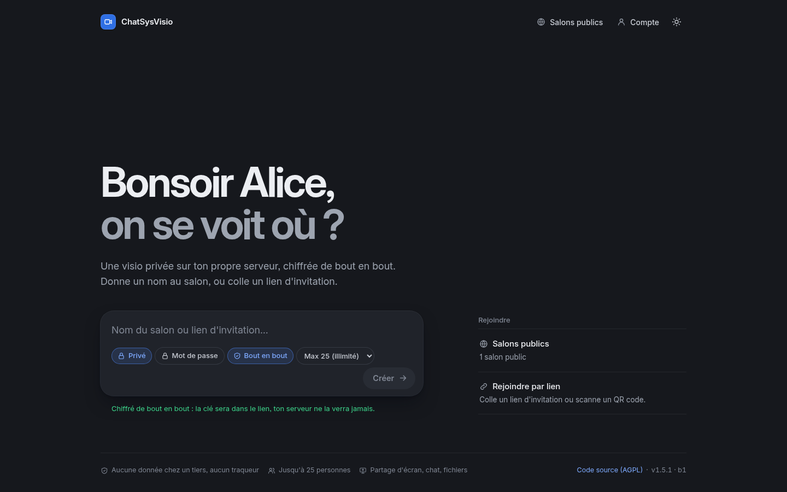
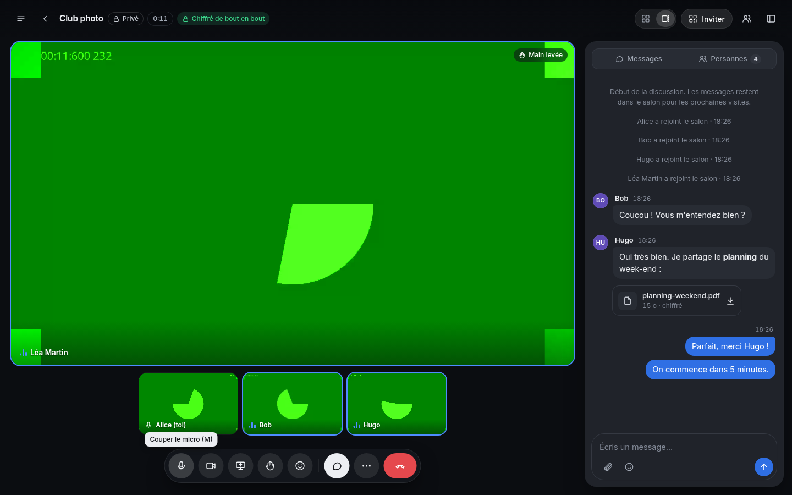
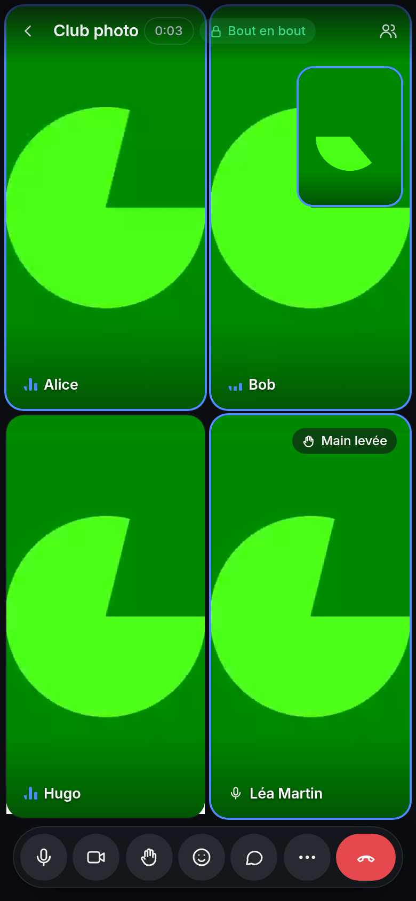
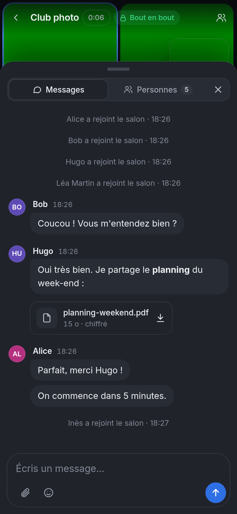

# ChatSysVisio — Manuel d'installation et d'utilisation

*Version 1.5.1 · licence AGPL-3.0-or-later · fork de Camus*



## 1. Présentation

ChatSysVisio est une **visio + messagerie auto-hébergée**, en français, pour **25 personnes par salon**. Tout passe par
**un seul port, HTTPS 443** (pages, API, vidéo et son en WebSocket) : pas d'UDP, pas de serveur TURN, aucun autre port à
ouvrir. Aucune donnée n'est confiée à un tiers, aucun traqueur.

Fonctions principales :

- salons **publics** (listés sur la page « Salons publics ») ou **privés** (accessibles par lien), **mot de passe** facultatif,
  limite de participants ;
- **chiffrement de bout en bout** des salons privés : vidéo, son, écran, chat, réactions et fichiers sont illisibles pour
  le serveur ; la clé est dans le lien (`#k=…`), jamais envoyée au serveur ;
- vidéo jusqu'en **1080p** (Auto / 360p / 720p / 1080p / Éco), HD envoyée seulement à qui l'affiche en grand ;
- mosaïque paginée ou **mode orateur**, partage d'écran, plein écran, image dans l'image ;
- **flou** et **arrière-plans** (détourage MediaPipe exécuté dans le navigateur) ;
- chat : réponses, Markdown, réactions, **fichiers et images**, « … écrit » ; main levée, réactions ;
- invitation par lien ou **QR code** (généré localement), appli installable (PWA), thème sombre / clair, mobile ;
- **administration** (réseau local seulement, mot de passe + **TOTP**) ; **comptes** utilisateurs facultatifs.


## 2. Prérequis

| Élément | Recommandation |
|---|---|
| Hôte | Proxmox VE (ou toute machine Debian 13) |
| Conteneur | CT LXC **Debian 13 (trixie)**, **non privilégié**, 2 vCPU, 1 Go RAM, 8 Go disque (25 personnes) |
| Réseau | IP fixe sur le LAN (exemple : `10.0.0.20`) |
| Proxy | **Nginx Proxy Manager** (NPM) avec un certificat Let's Encrypt |
| DNS | un nom public (exemple : `chat.example.com`) pointant vers votre IP publique |
| Routeur | port **443** redirigé vers NPM (et 80 pour Let's Encrypt) — jamais le port 8790 du CT |
| Navigateurs | Chrome / Edge / Brave, Firefox, Safari (macOS, iPhone, iPad), Chrome Android — HTTPS obligatoire |

Le paquet autonome n'a besoin **d'aucun accès Internet** pendant l'installation : il contient le code, ses dépendances,
la police Inter, MediaPipe et son modèle, et **Node.js 24 officiel** (linux-x64 et linux-arm64, empreinte SHA256 vérifiée).

## 3. Installation autonome pas à pas (CT Proxmox)

### 3.1 Créer le CT

1. Proxmox → **Create CT** : décocher rien de spécial, laisser **Unprivileged container** coché ; *nesting* inutile.
2. Template : `debian-13-standard` ; disque 8 Go ; 2 cœurs ; 1024 Mo de RAM.
3. Réseau : IP statique, ex. `10.0.0.20/24`, passerelle `10.0.0.1`.
4. Démarrer le CT, ouvrir la console (ou `ssh root@10.0.0.20`).

### 3.2 Copier et vérifier l'archive

Depuis votre poste :

```bash
scp chatsysvisio-1.5.1.tar.gz chatsysvisio-1.5.1.tar.gz.sha256 root@10.0.0.20:/root/
```

Sous Windows, WinSCP ou `pscp` (PuTTY) font la même chose. Dans le CT :

```bash
cd /root
sha256sum -c chatsysvisio-1.5.1.tar.gz.sha256      # doit afficher : OK
tar -xzf chatsysvisio-1.5.1.tar.gz
cd chatsysvisio-1.5.1
sha256sum -c --quiet SHA256SUMS                     # intégrité de chaque fichier (aucune sortie = OK)
```

### 3.3 Lancer l'installation

```bash
bash install.sh
```

Questions (Entrée = valeur proposée) :

| Question | Exemple |
|---|---|
| Adresse publique | `https://chat.example.com` |
| IP de Nginx Proxy Manager | `10.0.0.10` |
| N'accepter que NPM | `o` (recommandé) |
| Port local | `8790` |
| Création de salon anonyme | `o` |
| Résumé par un assistant local (Ollama) | `n` |

Sans questions :

```bash
NONINTERACTIVE=1 PUBLIC_URL=https://chat.example.com NPM_IP=10.0.0.10 bash install.sh
```

Le script :

- vérifie et installe **Node.js embarqué** dans `/opt/chatsysvisio-node` (aucun paquet téléchargé) ;
  `USE_SYSTEM_NODE=1 bash install.sh` utilise à la place `nodejs` des dépôts Debian (nécessite Internet) ;
- crée l'utilisateur système `chatsysvisio` (sans shell), la configuration `/etc/chatsysvisio/chatsysvisio.env` (0600),
  les données `/var/lib/chatsysvisio` ;
- copie le code dans `/opt/chatsysvisio` (lecture seule pour le service) ;
- installe les services `chatsysvisio.service` (durci : utilisateur dédié, système en lecture seule…), la sauvegarde
  nocturne `chatsysvisio-backup.timer` et la CLI `chatsysvisio-admin` ;
- démarre le service et vérifie `/healthz` ; propose de créer l'administrateur.

Contrôle : `systemctl status chatsysvisio` puis `curl -s http://127.0.0.1:8790/healthz` → `{"ok":true,…}`.

> Node embarqué : il n'est pas mis à jour par `apt`. Pour suivre les correctifs de sécurité de Node, installez la
> version suivante du paquet ChatSysVisio, ou passez à `USE_SYSTEM_NODE=1` (Node 20 de Debian, mis à jour automatiquement).

## 4. Nginx Proxy Manager et DNS

### 4.1 DNS

Chez votre registraire : un enregistrement **A** (et **AAAA** si IPv6) `chat.example.com` → votre IP publique.
Recommandé : un enregistrement **CAA** `0 issue "letsencrypt.org"`.

### 4.2 Proxy Host

**Hosts → Proxy Hosts → Add Proxy Host**

| Onglet | Champ | Valeur |
|---|---|---|
| Details | Domain Names | `chat.example.com` |
| | Scheme / Forward Hostname / Port | `http` / `10.0.0.20` / `8790` |
| | Cache Assets | **désactivé** |
| | Block Common Exploits | activé |
| | **Websockets Support** | **activé** (indispensable : la vidéo et le son passent par là) |
| SSL | Certificate | Let's Encrypt (Request a new SSL Certificate) |
| | Force SSL, HTTP/2 | activés |
| | **HSTS Enabled** | **désactivé** : ChatSysVisio envoie lui-même un HSTS conforme (2 ans, includeSubDomains, preload) |

Onglet **Advanced** :

```nginx
proxy_read_timeout 3600s;
proxy_send_timeout 3600s;
proxy_buffering off;
client_max_body_size 12m;
```

N'ajoutez **aucun en-tête de sécurité** dans NPM : l'application les envoie tous (CSP, HSTS, COOP/COEP…) ; des doublons
feraient baisser la note.

Vérification : `https://chat.example.com/healthz`.

## 5. Première connexion et administrateur (TOTP)

1. Ouvrez `https://chat.example.com` : saisissez votre prénom, créez un salon. Autorisez caméra et micro.
2. Créez l'administrateur **dans le CT, en root** :

   ```bash
   chatsysvisio-admin create-admin
   ```

   - mot de passe de 12 caractères minimum (saisie masquée) ;
   - un **QR code** s'affiche dans le terminal : scannez-le avec une application TOTP (Aegis, 2FAS, Google
     Authenticator, 1Password…) ;
   - notez hors ligne les **10 codes de secours** à usage unique ;
   - saisissez un premier code pour confirmer.
3. L'administration est à `https://chat.example.com/admin/` **depuis le réseau local uniquement** (les autres reçoivent un
   404). Connexion : identifiant + mot de passe + code à 6 chiffres.


## 6. Tunnel SSH vers l'administration

Depuis l'extérieur (ou si `/admin` est bloqué dans NPM), passez par un tunnel SSH : l'administration accepte HTTP en
boucle locale.

**OpenSSH** (Linux, macOS, Windows 10+) :

```bash
ssh -L 8790:127.0.0.1:8790 root@10.0.0.20
```

puis ouvrez `http://127.0.0.1:8790/admin/` sur votre poste.

**PuTTY** (Windows) :

1. *Session* : Host Name `10.0.0.20`, port 22.
2. *Connection → SSH → Tunnels* : Source port `8790`, Destination `127.0.0.1:8790`, **Local**, bouton **Add**.
3. Revenez à *Session*, enregistrez, **Open**, connectez-vous.
4. Ouvrez `http://127.0.0.1:8790/admin/`.

Pour atteindre le CT depuis Internet, passez par un VPN ou un bastion : n'exposez jamais le port 22 directement.

## 7. Utilisation (participants)

### Salons

- **Créer** : page d'accueil → nom du salon → options **Privé / Public**, **Mot de passe**, **Bout en bout**, limite de
  participants → **Créer**.
- **Public** : listé sur « Salons publics », chiffré jusqu'au serveur (TLS) seulement, c'est affiché.
- **Privé** : seul le lien y mène. **Bout en bout** activé par défaut : partagez **le lien complet** (bouton
  « Copier le lien » ou QR code). Sans la partie `#k=…`, on voit « Lien incomplet ».
- **Mot de passe** : demandé à l'entrée, en plus du lien.
- Le **cadenas** dans l'en-tête affiche l'état du chiffrement et un **code de sécurité** à comparer à voix haute.


### Salle d'attente

Aperçu caméra, niveau du micro, choix de la caméra, du micro et du haut-parleur, **flou** ou **arrière-plan** (images
fournies ou la vôtre), puis **Rejoindre**.

### Pendant l'appel

| Action | Où |
|---|---|
| Micro, caméra, partage d'écran, main levée, réactions | dock en bas |
| Chat, fichiers et images (10 Mo par défaut) | bouton bulle → onglet Messages ; trombone pour joindre |
| Liste des personnes | onglet Personnes |
| **Mode orateur** / grille | boutons en haut à droite |
| Épingler, plein écran, image dans l'image | menu d'une vignette |
| Qualité (Auto, 360p, 720p, **1080p**, Éco) | menu « … » → Qualité vidéo |
| Flou / arrière-plan, appareils | menu « … » → Arrière-plan et appareils |
| Infos techniques (diagnostic) | menu « … » |
| Inviter (lien, QR) | bouton Inviter |

L'en-tête et le dock s'effacent après quelques secondes sans mouvement ; bougez la souris pour les retrouver.



### Mobile

Ouvrez le lien dans Safari (iPhone) ou Chrome (Android). « Ajouter à l'écran d'accueil » installe l'appli. Le chat
et le menu s'ouvrent en tiroir depuis le bas ; glissez vers le bas pour fermer. Flou et arrière-plan sont limités à 720p
sur mobile pour préserver la batterie.

 

## 8. Administration


- **Vue d'ensemble** : débits, CPU, RAM, disque, salons et participants, version.
- **Salons** : participants, **exclure** (avec bannissement temporaire), **fermer** ou **supprimer** un salon.
- **Réglages à chaud** : création anonyme et code de création, limite par salon, quotas, taille des fichiers,
  mode d'inscription (fermé, ouvert, invitation, validation), création réservée aux comptes, invités.
- **Comptes** : valider, désactiver, supprimer, réinitialiser un mot de passe ; codes d'invitation.
- **Journal** : connexions, blocages, refus, actions admin (sans aucun secret).
- **Système** : sauvegarde immédiate, liste des sauvegardes, mises à jour Debian en attente.

Les réglages modifiés ici sont enregistrés dans `/var/lib/chatsysvisio/settings.json` et ont priorité sur le `.env`.

## 9. Mot de passe, TOTP et déblocage

En root dans le CT (`--user NOM` si l'identifiant n'est pas `admin`) :

| Situation | Commande |
|---|---|
| Lister les administrateurs | `chatsysvisio-admin list` |
| Mot de passe oublié | `chatsysvisio-admin reset-password` |
| Téléphone perdu / nouveau TOTP | `chatsysvisio-admin reset-totp` (nouveau QR + nouveaux codes de secours) |
| Compte bloqué (5 échecs → 15 min) | `chatsysvisio-admin unlock` |
| Supprimer un administrateur | `chatsysvisio-admin delete --user NOM` |

Un code de secours remplace une fois le code TOTP à la connexion.

## 10. Mises à jour et sauvegardes

**Mise à jour** avec un nouveau paquet autonome (la configuration et les données sont conservées) :

```bash
tar -xzf chatsysvisio-<version>.tar.gz && cd chatsysvisio-<version> && bash update.sh
```

`update.sh` sauvegarde d'abord (`/var/backups/chatsysvisio/chatsysvisio-maj-DATE.tar.gz`), garde l'ancien code dans
`/opt/chatsysvisio.prev` et revient automatiquement en arrière si la nouvelle version ne démarre pas. Ensuite, chaque
participant recharge la page avec **Ctrl+F5** (Cmd+Maj+R sur Mac ; fermer / rouvrir l'onglet sur mobile).

**Sauvegardes** : automatiques chaque nuit, 14 jours, dans `/var/backups/chatsysvisio`.

| Action | Commande |
|---|---|
| Sauvegarde immédiate | `systemctl start chatsysvisio-backup` (ou bouton dans l'administration) |
| Restaurer | `systemctl stop chatsysvisio && tar -C / -xzf /var/backups/chatsysvisio/<archive> && systemctl start chatsysvisio` |
| Sauvegarde Proxmox | une sauvegarde *vzdump* du CT complète utilement les archives ci-dessus |

Aucune vidéo ni aucun son n'est enregistré. Les salons inactifs sont supprimés après 30 jours.

## 11. Sécurité et note A+ WebGuardian

- en-têtes stricts envoyés par l'application : **CSP** sans `unsafe-inline`, **HSTS** 2 ans + preload, X-Frame-Options,
  nosniff, Referrer-Policy, Permissions-Policy, COOP / COEP / CORP ;
- cookies `__Host-` Secure, HttpOnly, SameSite=Strict ; jeton **CSRF** + contrôle d'Origin sur chaque requête d'écriture ;
- chiffrement de bout en bout des salons privés (AES-GCM, clé dans le fragment du lien) ;
- administration invisible hors réseau local (404), mot de passe scrypt + TOTP, blocage après 5 échecs ;
- service systemd durci, code en lecture seule, utilisateur dédié sans shell ;
- `ALLOW_FROM` limite le port 8790 à NPM.

Contrôle :

```bash
bash /opt/chatsysvisio/deploy/security-scan.sh
```

Il vérifie les en-têtes en local puis interroge https://webguardian.cloud (objectif **A+ 100/100**). Pour l'obtenir :
HSTS **désactivé** dans NPM, aucun en-tête ajouté dans NPM, Force SSL activé.

Code source : conformément à l'AGPL, `/source.tar.gz` sert le code exact de la version en service.

## 12. Dépannage

| Symptôme | Cause et solution |
|---|---|
| **Pas de son** après une mise à jour | un onglet est resté sur l'ancienne version : **Ctrl+F5** (Cmd+Maj+R sur Mac, fermer / rouvrir l'onglet sur mobile). Vérifier aussi que le navigateur n'a pas coupé le son de l'onglet. |
| **Administration en 404** | normal hors réseau local : l'adresse réelle du client n'est pas dans `ADMIN_ALLOW_CIDR`. Vérifier que l'IP de NPM figure dans `TRUSTED_PROXIES`, qu'un `location /admin { deny all; }` n'est pas posé dans NPM, ou passer par le **tunnel SSH** (§ 6). Vérifier `ADMIN_PATH`. |
| **ERR_EMPTY_RESPONSE** | la connexion arrive d'une IP non listée dans `ALLOW_FROM` (le serveur la coupe sans réponse) — ajouter l'IP de NPM ou vider `ALLOW_FROM` ; ou on a tapé `https://IP:8790` alors que le port local parle HTTP. |
| **« Jeton CSRF invalide »** | page ouverte depuis longtemps, cookies bloqués ou adresse différente de `PUBLIC_URL` (Origin refusée) : recharger la page, utiliser exactement `PUBLIC_URL`, autoriser les cookies du site. |
| Vidéo noire / « Websockets » | activer **Websockets Support** dans NPM ; ajouter les `proxy_read_timeout`. |
| Caméra refusée | HTTPS obligatoire ; autoriser la caméra dans le cadenas de la barre d'adresse. |
| « Lien incomplet » | le lien a été coupé : recopier le lien complet avec `#k=…`. |
| **Couleurs un peu différentes sous Firefox** | Firefox ignore l'espace colorimétrique des images VP8 à l'affichage : teintes légèrement décalées (jaune plus vert, contrastes accentués). Chrome, Edge et Safari sont fidèles. Contournement : utiliser Chrome / Edge, ou un autre navigateur côté émetteur. |
| Service arrêté | `journalctl -u chatsysvisio -n 80` ; `systemctl restart chatsysvisio`. |

Diagnostic : menu « … » → **Infos techniques** (versions, codecs, paquets envoyés / reçus / décodés). Rien n'est envoyé.

## 13. Migration depuis l'ancien nom

Voir `docs/MIGRATION.md`.

---
ChatSysVisio est un fork de Camus (© Morgan Robertson et contributeurs), sous licence GNU AGPL-3.0-or-later.
